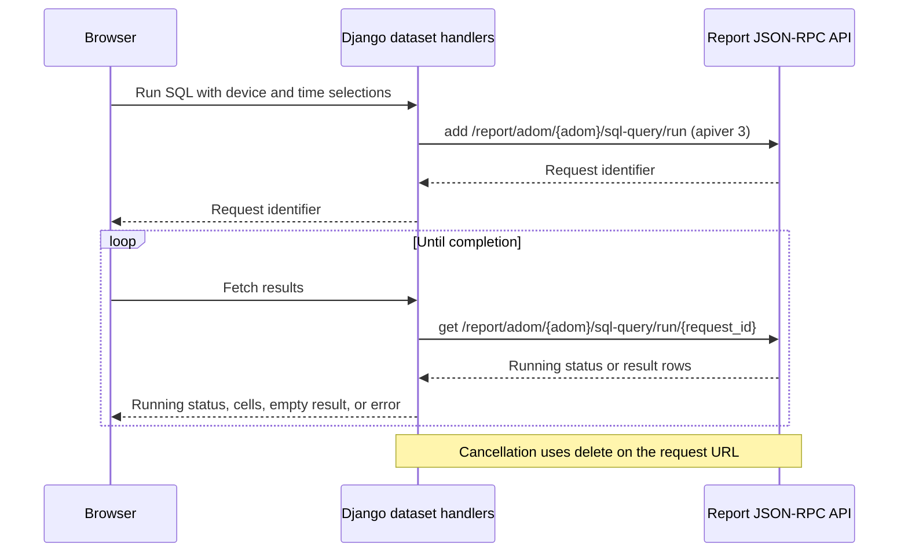
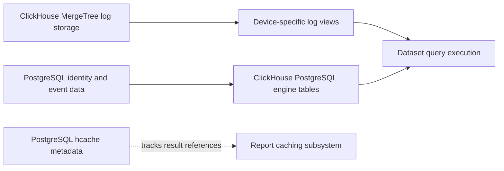
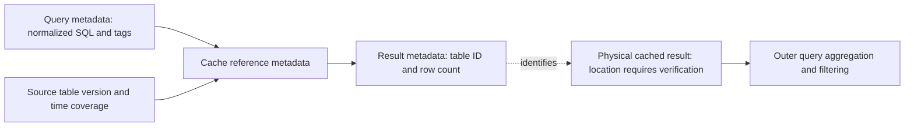
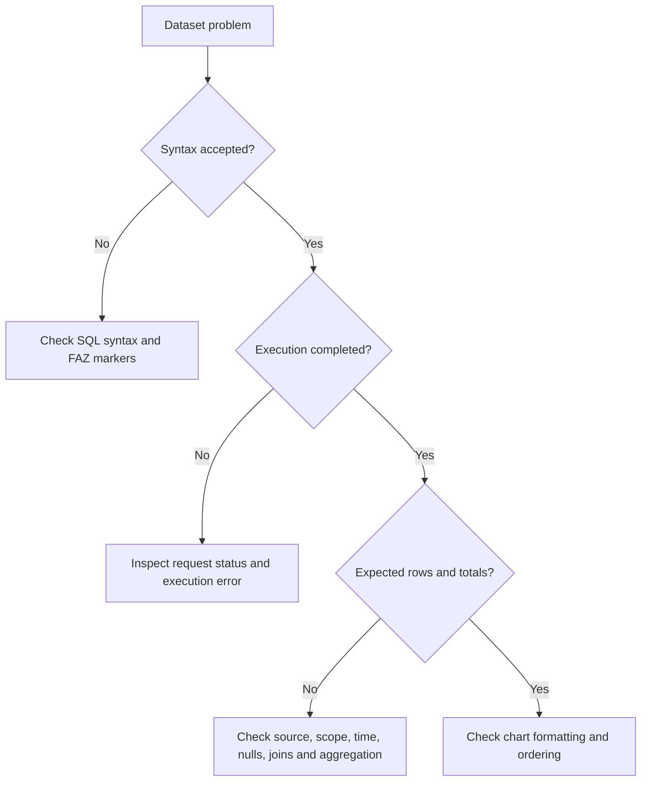
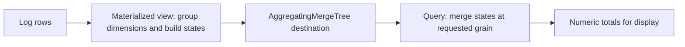

# FortiAnalyzer Dataset Query Writing Guide

This guide targets FortiAnalyzer 7.6.8 dataset queries for the GUI report engine. Verification is in progress against a lab appliance reporting v7.6.8 build 3788. Sections not yet reviewed must not be treated as verified merely because this baseline has changed.

> **Review status (2026-10-31):** This is an incremental 7.6.8 revision, not a fully validated reference. Architecture, selected schemas and helpers, join behavior, and SOC aggregate counts have supporting appliance checks. Report-context expansion, caching lifecycle, Fabric/drilldown behavior, and complete example execution remain open. FortiGate traffic/event views were empty during testing. See [verification notes](verification-7.6.8.md) for evidence and limitations.

---

## Table of Contents

1. [Architecture Overview](#1-architecture-overview)
2. [Dataset Metadata and `log_category`](#2-dataset-metadata-and-log_category)
3. [Log Source Variables (`$log-*`)](#3-log-source-variables-log-)
4. [Filter Variables](#4-filter-variables)
5. [Time Variables and Functions](#5-time-variables-and-functions)
6. [The HCache Mechanism (`###...###`)](#6-the-hcache-mechanism-)
7. [ADOM Reference Tables](#7-adom-reference-tables)
8. [SOC Event and Incident Tables](#8-soc-event-and-incident-tables)
9. [Essential Helper Functions](#9-essential-helper-functions)
10. [The `logflag` Bitmask](#10-the-logflag-bitmask)
11. [Query Patterns by Use Case](#11-query-patterns-by-use-case)
12. [Multi-Statement Queries with Temp Tables](#12-multi-statement-queries-with-temp-tables)
13. [The `SkipSTART`/`SkipEND` Hint](#13-the-skipstartskipend-hint)
14. [Common Mistakes and How to Avoid Them](#14-common-mistakes-and-how-to-avoid-them)
15. [Full Examples by Log Category](#15-full-examples-by-log-category)
16. [Column Reference by Log Source](#16-column-reference-by-log-source)
17. [Key Enum Values](#17-key-enum-values)
18. [Column Gotchas and Type Notes](#18-column-gotchas-and-type-notes)
19. [`logid` Reference](#19-logid-reference)
20. [The `fabricStart`/`fabricEnd` Hint](#20-the-fabricstartfabricend-hint)
21. [Troubleshooting](#21-troubleshooting)

**Appendix — Advanced / Dashboard Features**

A. [Drilldown Queries](#appendix-a-drilldown-queries)
B. [Materialized View Queries (`fv_*`)](#appendix-b-materialized-view-queries-fv_)

---

## 1. Architecture Overview

Dataset queries use FortiAnalyzer SQL variables and hints. The GUI submits SQL together with the ADOM, device selection, time range, log type, and device type. A successful parser rewrite alone does not establish that a dataset will execute correctly in that context.

### Dataset execution and result polling

The following flow is verified from the Python handlers on the 7.6.8 build 3788 lab appliance. It describes interactive dataset execution; scheduled report generation requires a separate trace.



The report data-access layer sends `query`, `device`, `time-range`, `logtype`, and `devtype` to the report API. The fetch endpoint retrieves an existing request; it is not the endpoint that submits the original SQL. Both logview and report expose dataset fetch handlers.

On completion, the GUI handler converts returned row objects into a header row and cell rows. A query still running, an empty result, and an execution error are distinct outcomes. Diagnose them separately.

### SQL parsing and rewriting

The appliance includes `/usr/local/python/sql_rewriter/app.py`, a Flask JSON-RPC service with these methods:

| Method | Implementation | Purpose |
|---|---|---|
| `sqlrewriter.rewrite` | `FazSQLConvertor` | Convert SQL syntax; accepts `skip_fabric` |
| `sqlrewriter.fabricrewrite` | `FazFabricSQLConvertor` | Fabric SQL conversion |
| `sqlrewriter.logfields` | `FazSQLField` | Extract referenced fields with device/log-type context |

These classes use the bundled ANTLR parser. The service returns conversion status and rewritten SQL; conversion is separate from query execution and result caching.

**Do not confuse report-template inspection with SQL variable expansion.** In this build, `FazReportSQL.parseFazKeyword(html_lines)` extracts names from `<fazchart>` and `<fazmacro>` HTML tags. `getReportSQL()` then maps charts to dataset SQL and substitutes its compiled macro dictionary. This does not establish that Django calls this class to expand `$log`, `$filter`, or hcache blocks at runtime.

The inspected GUI code delegates execution to the report JSON-RPC API. The precise downstream ownership and ordering of variable expansion, cache lookup, and rewriting must be established in that backend; they cannot be inferred from the presence of the rewriter service.

### Scope and storage

Use logical sources such as `$log-traffic` and include `$filter` when reading logs. Keep ADOM, devices, and time selection in the execution context. Hardcoded physical table names bypass the portable dataset abstraction.

The local ClickHouse metadata confirms a `MergeTree` log table (`tlog_sp1`), a FortiGate traffic view (`sp1_FGT_tlog`), and `PostgreSQL` engine tables including `faz_fabric_endpoints`, `faz_fabric_endusers`, and `faz_fabric_epeudevmap`. This verifies their definitions, not successful execution of every proposed join. Cache metadata does not establish the physical location or lifetime of cached result rows.



The physical log table uses typed storage slots such as `uint64_1` and `ip_1`; the device-specific view exposes semantic names such as `sentbyte` and `srcip`. Write datasets against logical log variables, not storage slots. In the inspected traffic view, `itime` and `dtime` are `DateTime`, IP fields are nullable `IPv6`, and byte counters are nullable `UInt64`. PostgreSQL template column types do not necessarily describe ClickHouse view types.

### Data Storage: ClickHouse vs PostgreSQL

FAZ uses two databases internally. Understanding which data lives where explains why certain joins work and why the FAZ variables exist.

**ClickHouse** — log storage (fast columnar analytics):
- All raw log data — the rows behind `$log-traffic`, `$log-event`, `$log-webfilter`, etc.
  Stored as MergeTree tables: `tlog_sp1`, `elog_sp1`, `ulog_sp1`, `Xlog_sp1`
- Log views — `sp1_FGT_tlog`, `adom3_FGT_tlog`, etc. (scoped views over raw tables)
- Materialized views — `fv_*` (pre-aggregated metrics, used by performance dashboards)

**PostgreSQL** — identity, SIEM, and metadata (relational, lower volume):
- Endpoint/asset identity: `endpoints`, `endpoints_attr`, `endpoints_history`, `endpoints_software`, `endpoints_vuln_map`, `endpoints_iot_info`
- User identity: `endusers`, `endusers_attr`, `endusers_history`
- Mapping: `epeudevmap` (endpoint↔user↔device), `epmacip` (MAC↔IP)
- Device registry: `devtable`, `adomdevtable`, `devgrptable`
- SIEM alerts & incidents: per-ADOM `{DEV}-alerts`, `{DEV}-incidents`, `{DEV}-indicators`, etc.
- Risk scores: `risk_score_evts`, `risk_score_hist`
- UEBA events: `ueba_epeu_events`
- Policy info: `fgt_policy`, `fgt_policy_conf`, `fgt_policy_stats`
- Query cache (hcache): `{DEV}-hcache_query/ref/res`
- Fabric aggregated views: `faz_fabric_endpoints`, `faz_fabric_endusers`, etc.
- Log metadata/stats: `log_tablst`, `logstat-*`

**The bridge — PostgreSQL proxy tables in ClickHouse:**
The `siem` ClickHouse database contains table definitions that transparently proxy to PostgreSQL using the ClickHouse `PostgreSQL()` engine. This is how a single dataset query can JOIN raw log rows (ClickHouse) with endpoint or alert data (PostgreSQL) without leaving the ClickHouse query engine.

From a query-writing perspective, **you never deal with this directly.** The FAZ variables abstract it completely:

| FAZ variable | Resolves to | Backed by |
|---|---|---|
| `$log-traffic`, `$log-event`, etc. | ClickHouse log views | ClickHouse |
| `$ADOM_ENDPOINT` | `faz_fabric_endpoints` | PostgreSQL (via CH proxy) |
| `$ADOM_ENDUSER` | `faz_fabric_endusers` | PostgreSQL (via CH proxy) |
| `$ADOM_EPEU_DEVMAP` | `faz_fabric_epeudevmap` | PostgreSQL (via CH proxy) |
| `$event` | per-ADOM `{DEV}-alerts` | PostgreSQL (via CH proxy) |
| `$incident` | per-ADOM `{DEV}-incidents` | PostgreSQL (via CH proxy) |
| `$event_history` | per-ADOM `{DEV}-event_history` | PostgreSQL (via CH proxy) |
| `$incident_history` | per-ADOM `{DEV}-incident_history` | PostgreSQL (via CH proxy) |
| `fv_fgt_t_*`, `fv_ffw_e_*`, etc. | Materialized views | ClickHouse |

---

## 2. Dataset Metadata and `log_category`

Every FAZ dataset is more than just a SQL query — it is a named object with metadata that the query engine uses to resolve `$log` and scope the query correctly.

### Key dataset properties

| Property | Description |
|---|---|
| `name` | Dataset identifier, referenced by chart/table widgets in reports |
| `description` | Human-readable description |
| `log_category` | Determines what `$log` resolves to (see table below) |
| `query` | The SQL body — the content this guide focuses on |

### `log_category` values

This is the most important metadata field. It tells the engine which log type `$log` should resolve to when no explicit `$log-*` variable is used. It also controls which device types are included in `$filter`.

| `log_category` value | `$log` resolves to | Use for |
|---|---|---|
| `"traffic"` | `$log-traffic` | Firewall/session queries |
| `"webfilter"` | `$log-webfilter` | Web filter queries |
| `"app-ctrl"` | `$log-app-ctrl` | Application control |
| `"attack"` | `$log-attack` | IPS/intrusion queries |
| `"virus"` | `$log-virus` | Antivirus queries |
| `"event"` | `$log-event` | System/device event queries |
| `"dns"` | `$log-dns` | DNS filter queries |
| `"dlp"` | `$log-dlp` | Data loss prevention |
| `"emailfilter"` | `$log-emailfilter` | Email filter queries |
| `"content"` | `$log-content` | VoIP/IM content queries |
| `"file-filter"` | `$log-file-filter` | File filter queries |
| `"fct-traffic"` | `$log-fct-traffic` | FortiClient traffic |
| `"fct-event"` | `$log-fct-event` | FortiClient events |
| `""` (empty) | N/A — no log source | SOC/SIEM queries (`$event`, `$incident`) |

**Rules:**
- Always set `log_category` to match the primary log source your query reads from.
- If you use explicit `$log-traffic` (instead of `$log`), the `log_category` still matters — it controls device scoping in `$filter`.
- Queries with `log_category: ""` are for SOC tables only and should use `/*fabricStart*/`/`/*fabricEnd*/` if they need to aggregate across ADOMs.
- You can use `$log-traffic` in a dataset with `log_category: "webfilter"` but it is not recommended — the device scoping in `$filter` will be based on webfilter-capable devices, not all traffic devices.

### Using `$log` vs `$log-{category}`

Both work. The difference:
- `$log` — resolves to whatever `log_category` is set to. More portable if you want to reuse the query with different categories, but makes the query's intent less obvious.
- `$log-traffic` — explicit. Always resolves to traffic regardless of `log_category`. Preferred for clarity.

Use the form appropriate to the dataset context. An explicit source improves readability; it does not replace device, ADOM, and time scoping.

---

## 3. Log Source Variables (`$log-*`)

Use `$log` or `$log-{category}` as the FROM table. The engine resolves these to the correct scoped view.

| Variable | Log Category |
|---|---|
| `$log` | Same as dataset's `log_category` |
| `$log-traffic` | Traffic/firewall sessions |
| `$log-webfilter` | Web filter events |
| `$log-app-ctrl` | Application control |
| `$log-attack` | IPS/attack events |
| `$log-virus` | Antivirus events |
| `$log-event` | System/device events |
| `$log-dlp` | Data loss prevention |
| `$log-dns` | DNS filter events |
| `$log-emailfilter` | Email filter |
| `$log-content` | Content events (VoIP, etc.) |
| `$log-fct-traffic` | FortiClient traffic |
| `$log-fct-event` | FortiClient events |
| `$log-file-filter` | File filter events |

**Rules:**
- For a dataset with `log_category: "traffic"`, use `$log` or `$log-traffic` — both resolve to the same thing.
- Combine categories using explicit sources and an appropriate JOIN or UNION ALL. Align output columns and types for a union; choose join keys that preserve the intended row count.
- Never hardcode `sp1_FGT_tlog` or similar view names — these are internal and not ADOM-scoped.

**Further log types:** `$log-ssl`, `$log-ssh`, `$log-waf`, `$log-voip`, `$log-gtp`, `$log-protocol`, `$log-security`, `$log-siem` and `$log-netscan` also work as `$log-` variables (tested on FAZ 7.6). Never hardcode the internal view names. `$log-netscan` holds logs of the FortiOS 5.x network vulnerability scanner, which current FortiOS no longer has. For full column details for each log source, see §16.

> For the full column schema of each log source, see §16 (Column Reference by Log Source).

---

## 4. Filter Variables

These are injected by the GUI based on user selections (time range, device, ADOM).

### `$filter`
The primary filter. Always include it in every raw log query. It enforces the report time window and device scope.

```sql
SELECT hostname, count(*) as hits
FROM $log
WHERE $filter
  AND hostname IS NOT NULL
GROUP BY hostname
ORDER BY hits DESC
```

### `$filter-drilldown`
> **Dashboard feature** — only relevant when reading existing built-in drilldown datasets. Users cannot create new drilldown datasets. See [Appendix A](#appendix-a-drilldown-queries) for full details.

Used in drilldown queries applied to the **outer** query of an hcache pattern. The cached inner result already applied `$filter`; the outer query narrows further based on a drilldown selection (e.g. a specific user or application clicked in the GUI).

```sql
SELECT app, sum(sessions) as sessions
FROM ###(SELECT app, count(*) as sessions
         FROM $log
         WHERE $filter
         GROUP BY app
         ORDER BY sessions DESC)### t
WHERE $filter-drilldown   -- narrows outer result to selected drilldown value
GROUP BY app
ORDER BY sessions DESC
```

Note: Some older queries write `$filter - drilldown` (with spaces) — both work.

### `$dev_filter`
Device-only filter (no time range). Used when joining against non-log tables that already have correct scope.

### `$last3day_period`
Expands to the last 3 days time range. Used in queries that need a rolling lookback for baseline comparison, independent of the report's main period. Must be combined with `$filter` (not a replacement).

```sql
WHERE $last3day_period $filter AND ...
```

### `$pre_period`
The period immediately before the current report window. Used for before/after comparison queries — e.g. "this week vs last week". It expands to a condition **ending in `and`**, so it must be followed by another condition: before `$filter` (same syntax as `$last3day_period`), or `1=1` when used on its own.

```sql
-- Compare current period vs previous period session counts
SELECT
    sum(CASE WHEN $pre_period 1=1 THEN 1 ELSE 0 END) AS sessions_prev,
    sum(CASE WHEN $filter THEN 1 ELSE 0 END) AS sessions_curr
FROM $log-traffic
WHERE (($pre_period 1=1) OR ($filter)) AND (bitAnd(logflag,1)>0)
```

### `$adom_oid`
Integer ADOM OID for the current context. Rarely needed directly; `$filter` handles scoping automatically.

---

## 5. Time Variables and Functions

### `$flex_timestamp`
Groups log rows into time buckets appropriate for the report period (5 min, hour, or day). Use this in the innermost GROUP BY when building time-series data.

```sql
SELECT $flex_timestamp AS timestamp, srcip, sum(sentbyte) as traffic_out
FROM $log
WHERE $filter
GROUP BY timestamp, srcip
```

`$flex_timestamp` is a bucketing expression. The 7.6.8 parser accepts both the bare form and `$flex_timestamp(dtime)` with an explicit column; see the explicit-column example below. Parser acceptance does not establish the runtime bucket width, time zone, or result type: verify those through the dataset execution context.

### `$flex_timescale(col)`
Formats a bucketed timestamp column for display. Use in the outermost SELECT when presenting time-series to the GUI.

```sql
SELECT $flex_timescale(timestamp) AS hodex, sum(traffic_out) as traffic_out
FROM (...)
GROUP BY hodex
ORDER BY hodex
```

### `$fv_line_timescale(col)`
Like `$flex_timescale` but for queries reading from `fv_*` materialized views (which store pre-aggregated `timescale` column values).

```sql
SELECT $fv_line_timescale(timescale) AS time, sum(sessions) as sessions
FROM fv_fgt_t_src_dst_5min_sp1
WHERE $filter
GROUP BY time
ORDER BY time
```

### `$flex_datetime(col)` / `from_itime(col)` / `from_dtime(col)`
Convert integer epoch timestamps to human-readable datetime strings.

- `from_itime(itime)` — formats the ingestion-time field; the inspected 7.6.8 ClickHouse traffic view exposes `itime` as `DateTime`, not `Int32`
- `from_dtime(dtime)` — for `dtime`-style timestamps (used in event logs)
- `$flex_datetime(timestamp)` — adapts to report period format

```sql
SELECT from_itime($flex_timestamp) AS timestamp, user, msg
FROM $log
WHERE $filter
ORDER BY timestamp DESC
```

### `$hour_of_day` / `$hour_of_day(col)`
Groups by hour 0–23. Use for "by hour of day" distribution queries.

```sql
SELECT $hour_of_day AS hourstamp, count(*) AS requests
FROM $log-traffic
WHERE $filter
GROUP BY hourstamp
ORDER BY hourstamp
```

Or with an explicit column (e.g. when reading from a cached subquery result):
```sql
SELECT $hour_of_day(timestamp) AS hourstamp, sum(totalnum) AS totalnum
FROM ###(...)### t
GROUP BY hourstamp
ORDER BY hourstamp
```

### `$DAY_OF_MONTH` / `$day_of_week`
Similar to `$hour_of_day` but for day-of-month (1–31) and day-of-week (0=Sunday) distributions.

### `$cust_time_filter(col)` / `$cust_time_filter(col, PRESET)`
For filtering non-log tables (like incident or alert tables) by the report time window.

```sql
SELECT alertid, alerttime, severity
FROM $ADOM_ENDPOINT_alerts
WHERE $cust_time_filter(alerttime)
```

Presets: `TODAY`, `YESTERDAY`, `LAST_N_PERIOD,1`

### `$start_time` / `$end_time`
The raw start/end Unix timestamps of the report period. Available for use in expressions.

### `$timespan`
The report period duration in seconds. Useful for rate calculations.

### `$days_num`
The number of days in the report period. Use for computing daily averages:

```sql
SELECT cast(sum(sessions)/$days_num AS decimal(18,0)) AS avg_sessions_per_day
FROM ###(...)### t
```

### `$flex_timestamp(col)` (with explicit column argument)
`$flex_timestamp` normally reads `itime` implicitly. When you need to bucket by a different timestamp column, call it with an argument:

```sql
$flex_timestamp(dtime) AS timestamp   -- bucket by device time instead of ingestion time
```

### `$calendar_time`
Similar to `$flex_timestamp` but aligned to calendar boundaries (midnight, hour start). Used in config-change timeline queries where you want whole-hour or whole-day buckets rather than report-period-relative buckets.

```sql
SELECT $calendar_time AS timestamp, user, msg
FROM $log-event
WHERE $filter AND cfgtid > 0
GROUP BY timestamp, user, msg
ORDER BY timestamp
```

---

## 6. The HCache Mechanism (`###...###`)

HCache is FortiAnalyzer's report aggregation cache mechanism. The `###...###` markers identify an inner query for cache processing; the outer query consumes and can re-aggregate its output. Do not infer cache identity, lifetime, or physical result storage from the marker alone.

### How it works under the hood

On the 7.6.8 lab appliance, PostgreSQL's `hcache` schema contains three related metadata tables per scope. For `sp1`, catalog inspection shows:

| Table | Observed metadata |
|---|---|
| `sp1-hcache_query` | Query/base tags, normalized SQL, normalized aggregate SQL, creation time |
| `sp1-hcache_ref` | Query hash, source table ID/version, result table ID, allowed and log time ranges, access/update times, row count, result size, runtime |
| `sp1-hcache_res` | Result table ID/hash, result row count, reference-related count, flags |

`hcache_res` is a result **metadata** table, not a table holding arbitrary dataset output rows. The hash columns are `bigint`; their existence does not establish a SHA algorithm. The running appliance also has separate `sqlreportd` and `sqlrptcached` processes.



The schema records source versions and time coverage as well as query identity. Do not assume that a matching SQL string or tag alone guarantees reuse, that a scan runs exactly once, or that reuse has negligible cost. Cache lifetime and the scheduled-report execution path remain to be verified on this build. The inspected `sp1-hcache_ref` table was empty, so this inspection establishes the schema rather than runtime cache behavior.

### When to use hcache

Use hcache when **any** of the following apply:

**1. You need to filter on a computed or aliased column**

Tested on FAZ 7.6: ClickHouse does accept a SELECT alias in the same query's WHERE clause, so a plain `WHERE user_src IS NOT NULL` works. Hcache is still the better pattern when the computed column is reused, re-aggregated or shared with other datasets, because the expensive scan is cached.

```sql
-- Filter on the coalesce result in the outer query (cached inner scan)
SELECT user_src, sum(sessions) AS sessions
FROM ###(
    SELECT coalesce(nullifna(`user`), nullifna(`unauthuser`), ipstr(`srcip`)) AS user_src,
           count(*) AS sessions
    FROM $log-traffic
    WHERE $filter AND (bitAnd(logflag,1)>0)
    GROUP BY user_src
)### t
WHERE user_src IS NOT NULL   -- filter on the computed alias in the outer query
GROUP BY user_src
ORDER BY sessions DESC
```

**2. You need two levels of aggregation**

When you aggregate at fine granularity in the inner query (e.g. per-user-per-app-per-timestamp) and then re-aggregate at a coarser level in the outer query (e.g. per-user totals). Without hcache this requires either a subquery or duplicating the GROUP BY.

```sql
-- Inner: fine-grained (user + app + time bucket)
-- Outer: coarser (user totals only)
SELECT user_src, sum(bandwidth) AS bandwidth
FROM ###(
    SELECT coalesce(nullifna(`user`), nullifna(`unauthuser`), ipstr(`srcip`)) AS user_src,
           app, $flex_timestamp AS ts,
           sum(coalesce(sentdelta,sentbyte,0)+coalesce(rcvddelta,rcvdbyte,0)) AS bandwidth
    FROM $log-traffic
    WHERE $filter AND (bitAnd(logflag,bitOr(1,32))>0)
    GROUP BY user_src, app, ts
    /*SkipSTART*/ORDER BY bandwidth DESC/*SkipEND*/
)### t
GROUP BY user_src
ORDER BY bandwidth DESC
```

**3. Multiple datasets in the same report share the same base scan**

Any report that shows multiple charts from the same log source (e.g. "top users", "top apps", "traffic over time" — all from traffic logs) should use a named base cache so the ClickHouse scan happens once. See the named base cache section below.

**4. Time series queries**

The following hcache pattern supports two-level time-series aggregation. The `$flex_timestamp` bucketing goes in the inner GROUP BY, `$flex_timescale()` wrapping goes in the outer SELECT. This is the standard two-level aggregation pattern.

**5. You want sorted cache population for top-N**

The hint commonly wraps an inner ORDER BY. Its exact skip/trimming behavior remains unverified on this build; retain an outer ORDER BY for final top-N output.

### When NOT to use hcache

Skip hcache when:
- The query is a simple single-pass aggregation with no computed column filtering — the overhead of writing and reading the cache outweighs any benefit.
- You are querying a reference table (`$ADOM_ENDPOINT`, `$event`, etc.) rather than raw logs — these are already small and fast.
- The query is a detail/list query (no aggregation at all, just `SELECT ... ORDER BY itime DESC LIMIT 100`) — hcache is designed for aggregations, not row fetches.

```sql
-- Simple enough — no hcache needed
SELECT catdesc, count(*) AS hits
FROM $log-webfilter
WHERE $filter AND action = 'blocked' AND catdesc IS NOT NULL
GROUP BY catdesc
ORDER BY hits DESC
```

### Basic syntax

Template: `col_a`/`col_b`/`col_c` are placeholders for real columns.

```sql
SELECT col_a, sum(col_b) AS total
FROM ###(
    SELECT col_a, col_b, col_c
    FROM $log
    WHERE $filter
    GROUP BY col_a, col_b, col_c
    /*SkipSTART*/ORDER BY col_b DESC/*SkipEND*/
)### t
WHERE col_c = 'some_value'      -- filter on inner columns
GROUP BY col_a
ORDER BY total DESC
```

The alias `t` after `###` is required.

### Named base cache (`###base(...)base###`)

When multiple datasets in a report share the same expensive base query, wrap it in `###base(/*tag:label*/...)base###`. Keep the base SQL and required dimensions consistent wherever it is reused. A shared tag alone does not prove that the backend will perform only one scan.

The `/*tag:label*/` string labels the base query. Use the same label for the same intended base definition; do not reuse it for unrelated SQL. Cache metadata also records normalized SQL, source versions, and time coverage, so the label should not be described as the complete cache key. The convention from the built-in datasets is `rpt_base_{logtype}_{description}`.

**The most important predefined base cache — traffic bandwidth and sessions:**

This is the base query used by the built-in bandwidth, top-users, top-apps, and sessions reports. If you are writing any traffic-based dataset that belongs in a report alongside those, reuse this exact tag and query structure so your dataset shares the cache.

```sql
###base(/*tag:rpt_base_t_bndwdth_sess*/
    SELECT $flex_timestamp AS timestamp,
           dvid, srcip, dstip,
           epid, euid, appcat, apprisk,
           coalesce(nullifna(`user`), nullifna(`unauthuser`), ipstr(`srcip`)) AS user_src,
           service,
           sum(CASE WHEN (bitAnd(logflag,1)>0) THEN 1 ELSE 0 END) AS sessions,
           sum(coalesce(sentdelta,sentbyte,0)+coalesce(rcvddelta,rcvdbyte,0)) AS bandwidth,
           sum(coalesce(sentdelta,sentbyte,0)) AS traffic_out,
           sum(coalesce(rcvddelta,rcvdbyte,0)) AS traffic_in
    FROM $log-traffic
    WHERE $filter AND (bitAnd(logflag,bitOr(1,32))>0)
    GROUP BY timestamp, dvid, srcip, dstip, epid, euid, appcat, apprisk, user_src, service
    /*SkipSTART*/ORDER BY bandwidth DESC, sessions DESC/*SkipEND*/
)base###
```

This base query intentionally carries many dimensions (`dvid`, `srcip`, `dstip`, `epid`, `euid`, `appcat`, `apprisk`, `user_src`, `service`, `timestamp`) so that any dataset reading from it can group or filter by any subset. The outer query then re-aggregates to the specific dimensions it needs.

**Example: two datasets sharing the base**

```sql
-- Dataset 1: bandwidth timeline
SELECT $flex_timescale(timestamp) AS hodex,
       sum(traffic_out) AS traffic_out,
       sum(traffic_in) AS traffic_in
FROM ###(
    SELECT timestamp,
           sum(traffic_out) AS traffic_out,
           sum(traffic_in) AS traffic_in
    FROM ###base(/*tag:rpt_base_t_bndwdth_sess*/
        -- ... same base query as above ...
    )base### base_query
    GROUP BY timestamp
)### t
GROUP BY hodex
HAVING sum(traffic_out+traffic_in) > 0
ORDER BY hodex

-- Dataset 2: top users by bandwidth, reusing the same base definition
SELECT user_src, sum(bandwidth) AS bandwidth
FROM ###(
    SELECT user_src, sum(bandwidth) AS bandwidth
    FROM ###base(/*tag:rpt_base_t_bndwdth_sess*/
        -- ... same base query ...
    )base### base_query
    GROUP BY user_src
    /*SkipSTART*/ORDER BY bandwidth DESC/*SkipEND*/
)### t
GROUP BY user_src
ORDER BY bandwidth DESC
```

### What to put inside vs outside hcache

**Inside the `###(...)###`:**
- `FROM $log-*` with `WHERE $filter` — the raw log scan must be here
- All columns you might ever need to filter or group by in the outer query — you cannot reference a column in the outer WHERE if it was not selected in the inner query
- Aggregations at the finest granularity needed (user + app + timestamp, not just user)
- `/*SkipSTART*/ORDER BY col DESC/*SkipEND*/` when you want the cache sorted for top-N (see §13)

**Outside the `###(...)###`:**
- Final re-aggregation (SUM, COUNT over the cached rows)
- Filter conditions on computed columns (`WHERE user_src IS NOT NULL`, `WHERE app = 'HTTP'`)
- `HAVING` to filter on aggregated values (`HAVING sum(bytes) > 0`)
- Final `ORDER BY` and `LIMIT`
- `$flex_timescale(timestamp)` wrapping for time-series display

---

## 7. ADOM Reference Tables

These are logical names for FAZ-managed reference data. The 7.6.8 appliance has ClickHouse `PostgreSQL` engine tables for sources such as `faz_fabric_endpoints` and `faz_fabric_endusers`: underlying data resides in PostgreSQL but is exposed through ClickHouse table definitions. ADOM and Fabric scoping depend on variable expansion and query context; a physical proxy table name alone does not establish the intended scope.

| Variable | Contains |
|---|---|
| `$ADOM_ENDPOINT` | Endpoint devices (name, IP, MAC, etc.) |
| `$ADOM_ENDUSER` | End users (username, display name) |
| `$ADOM_EPEU_DEVMAP` | Endpoint-to-enduser device mapping |
| `$ADOM_INTF_INFO` | Interface information |
| `$ADOM_INTF_STATS` | Interface statistics |
| `$ADOM_SDWAN_INTF_INFO` | SD-WAN interface info |
| `$ADOMTBL_PLHD_POLINFO` | Policy information |
| `$ADOMTBL_PLHD_AUDIT_HST` | Audit history |
| `$ADOMTBL_PLHD_IOC_VERDICT` | IoC verdict data |

### Joining endpoint data to log data

The typical pattern for enriching log rows with endpoint/user information:

Before using this pattern, establish that each reference side contains at most one matching row per ID in the selected scope. The installed Fabric endpoint and user tables also carry `fazuid` and `adomoid`; joining globally on `epid` or `euid` alone can duplicate or misattribute log rows. The variable-expansion scoping of this example still requires runtime verification.

```sql
SELECT
    coalesce(f_user, euname, ipstr(`srcip`)) AS user_src,
    coalesce(epname, ipstr(`srcip`)) AS ep_src,
    sum(bandwidth) AS bandwidth
FROM (
    -- Step 1: aggregate from logs, carry epid/euid for joining
    SELECT dvid, f_user, srcip, ep_id, eu_id, sum(bandwidth) AS bandwidth
    FROM ###(
        SELECT dvid,
               coalesce(nullifna(`user`), nullifna(`unauthuser`)) AS f_user,
               srcip,
               (CASE WHEN epid < 1024 THEN NULL ELSE epid END) AS ep_id,
               (CASE WHEN euid < 1024 THEN NULL ELSE euid END) AS eu_id,
               sum(coalesce(sentbyte,0)+coalesce(rcvdbyte,0)) AS bandwidth
        FROM $log-traffic
        WHERE $filter AND (bitAnd(logflag,1)>0)
        GROUP BY dvid, f_user, srcip, ep_id, eu_id
        /*SkipSTART*/ORDER BY bandwidth DESC/*SkipEND*/
    )### t
    GROUP BY dvid, f_user, srcip, ep_id, eu_id
) log_data
-- Step 2: left join to resolve names
LEFT JOIN $ADOM_ENDPOINT ep ON log_data.ep_id = ep.epid
LEFT JOIN $ADOM_ENDUSER eu  ON log_data.eu_id  = eu.euid
GROUP BY user_src, ep_src
ORDER BY bandwidth DESC
```

**Note:** `epid < 1024` and `euid < 1024` are system/unassigned IDs — always null them out before joining.

### `devtable_ext` — Extended Device Table

A special reference table available in SOC/event queries that provides device name and type information by `dvid`. It is the standard way to resolve a numeric `dvid` to a human-readable device name.

| Column | Description |
|---|---|
| `dvid` | Device ID (join key — matches `dvid` on log rows and `$event`) |
| `devname` | Device display name |
| `devtype` | Device type string |
| `devid` | Device serial/identifier string |

```sql
-- Resolve device name in an alert query
SELECT e.triggername, d.devname, e.severity, count(*) AS cnt
FROM $event e
LEFT JOIN devtable_ext d ON e.dvid = d.dvid
WHERE $cust_time_filter(e.alerttime)
GROUP BY e.triggername, d.devname, e.severity
ORDER BY cnt DESC
```

---

## 8. SOC Event and Incident Tables

These are **SIEM-layer tables**, distinct from `$log-event` (device logs). They hold alerts and incidents created by the FAZ correlation engine.

| Variable | Description | Time filter column |
|---|---|---|
| `$event` | SIEM alerts (correlation hits) | `alerttime` |
| `$incident` | SIEM incidents | `createtime` |
| `$event_history` | Pre-aggregated alert counts by time bucket | `agg_time` |
| `$incident_history` | Pre-aggregated incident counts by time bucket | `agg_time` |

**`$event` columns:**

| Column | Type | Description |
|---|---|---|
| `alertid` | Int64 | Alert ID |
| `alerttime` | Int32 | Alert time (Unix epoch) — use `$cust_time_filter(alerttime)` |
| `updatetime` | Int32 | Last update time |
| `dvid` | Int32 | Device ID — join to `devtable_ext` for device name |
| `epid` / `euid` | Int32 | Endpoint/user IDs |
| `severity` | Int16 | **0=Critical, 1=High, 2=Medium, 3=Low** (numeric, not string) |
| `flags` | Int16 | Alert flags bitmask |
| `triggername` | Nullable(String) | Alert rule/trigger name |
| `tag` | Nullable(String) | Alert tag |
| `epip` | Nullable(String) | Endpoint IP string |
| `epname` | Nullable(String) | Endpoint name |
| `euname` | Nullable(String) | End-user name |
| `subject` | Nullable(String) | Alert subject/title |
| `eventtype` | Nullable(String) | Event type |
| `groupby1` / `groupby2` / `groupby3` | Nullable(String) | Alert grouping fields |
| `eventstatus` | Nullable(String) | Event status |
| `extrainfo` | Nullable(String) | Extra JSON info |
| `logtype` / `devtype` / `subtype` | Nullable(String) | Log/device type |
| `filterkey` | Int64 | Filter key |
| `firstlogtime` / `lastlogtime` | Int32 | First/last log timestamps |
| `logcount` | Int64 | Log count |
| `assignto` | Nullable(String) | Assigned analyst |
| `ackby` / `acktime` | Nullable(String)/Int64 | Acknowledged by/time |
| `indicator` | Nullable(String) | IOC indicator |

> **Severity decode:** `CASE severity WHEN 0 THEN 'Critical' WHEN 1 THEN 'High' WHEN 2 THEN 'Medium' WHEN 3 THEN 'Low' END`

**`$incident` columns:**

| Column | Type | Description |
|---|---|---|
| `incid` | Int64 | Incident ID — use `incid_to_str(incid)` for display |
| `epid` | Nullable(Int32) | Endpoint ID |
| `euid` | Nullable(Int32) | End-user ID |
| `endpoint` | Nullable(String) | Endpoint name string |
| `category` | Nullable(String) | Incident category |
| `severity` | Nullable(String) | `critical`, `high`, `medium`, `low` (String here, unlike `$event`) |
| `status` | Nullable(String) | `draft`, `analysis`, `response`, `closed`, `cancelled` |
| `description` | Nullable(String) | Incident description |
| `reporter` | Nullable(String) | Who/what created the incident |
| `createtime` | Nullable(Int32) | Creation timestamp |
| `lastupdate` | Nullable(Int32) | Last update timestamp |
| `lastuser` | Nullable(String) | Last modifying user |
| `assigned_to` | Nullable(String) | Assigned analyst |
| `remedy_action` | Nullable(String) | Remediation action |
| `remedy_executor` / `remedy_approver` | Nullable(String) | Executor/approver |
| `remedy_time` | Nullable(Int32) | Remediation time |
| `refinfo` | Nullable(String) | Reference info |

**`$event_history` columns:** `agg_time`, `num_sev_critical`, `num_sev_high`, `num_sev_medium`, `num_sev_low`, `num_total`

**`$incident_history` columns:** `agg_time`, `num_sta_draft`, `num_sta_analysis`, `num_sta_response`, `num_sta_closed`, `num_sta_cancelled`, `num_sev_critical`, `num_sev_high`, `num_sev_medium`, `num_sev_low`, `num_endpoint`

**Key patterns:**

```sql
-- Top alert trigger names today
SELECT triggername,
       CASE severity WHEN 0 THEN 'Critical' WHEN 1 THEN 'High'
                     WHEN 2 THEN 'Medium'   WHEN 3 THEN 'Low' END AS sev,
       count(*) AS cnt
FROM $event
WHERE $cust_time_filter(alerttime, TODAY)
GROUP BY triggername, severity
ORDER BY severity, cnt DESC

-- Open incidents
SELECT incid_to_str(incid) AS incnum,
       from_itime(createtime) AS ts,
       severity, status, endpoint, description
FROM $incident
WHERE $cust_time_filter(createtime)
  AND status NOT IN ('closed','cancelled')
ORDER BY CASE lower(severity) WHEN 'critical' THEN 0 WHEN 'high' THEN 1
         WHEN 'medium' THEN 2 WHEN 'low' THEN 3 ELSE 4 END, createtime DESC

-- Peak open-incident snapshot in each display bucket (single scoped history source)
SELECT $flex_timescale(agg_time) AS hodex,
       max(num_sta_draft + num_sta_analysis + num_sta_response) AS peak_open
FROM $incident_history
WHERE $cust_time_filter(agg_time)
GROUP BY hodex
ORDER BY hodex
```

> **`incid_to_str(incid)`:** The installed definition is `concat('IN', leftPad(toString(incid), 8, '0'))`; for example, 123 becomes `IN00000123`.

The history example takes the maximum of each row's combined open-state count. Summing separate maxima could combine peaks from different snapshots. This is a peak-snapshot metric, not newly created incidents or a sum across multiple ADOMs.

---

## 9. Essential Helper Functions

### `ipstr(col)`
Converts a Nullable(IPv6) column to a clean IPv4/IPv6 string. Always use this when displaying or comparing IP addresses — raw IPv6-mapped IPv4 addresses (e.g. `::ffff:192.168.1.1`) are not readable.

```sql
ipstr(`srcip`)   -- → "192.168.1.1"
ipstr(`dstip`)   -- → "10.0.0.1"
```

### `nullifna(col)`
Maps exactly `N/A`, `n/a`, `(none)`, and the empty string to SQL NULL. The literal string `null` is retained. Whitespace and other capitalization are not normalized by this helper.

```sql
nullifna(`user`)         -- NULL if user is "N/A", otherwise the value
nullifna(`unauthuser`)   -- same
```

### `coalesce(nullifna(`user`), nullifna(`unauthuser`), ipstr(`srcip`))`
The canonical user identity expression for traffic logs. Returns the first non-null of: authenticated username → unauthenticated username → source IP string.

```sql
coalesce(nullifna(`user`), nullifna(`unauthuser`), ipstr(`srcip`)) AS user_src
```

### `app_group_name(app)`
Normalizes application-name strings using punctuation. The installed helper retains strings containing a second underscore; otherwise, when both a dot and an underscore occur, it keeps the prefix before the underscore. Other inputs are retained. This is not an application-category lookup; use `appcat` when category grouping is intended.

```sql
app_group_name(app) AS app_group
```

### `root_domain(hostname)`
Extracts the root domain from a full hostname (e.g. `mail.google.com` → `google.com`). Use for domain-level aggregation in webfilter queries.

```sql
coalesce(root_domain(hostname), ipstr(dstip)) AS domain
```

### `get_devtype(devtype_int)`
Converts a numeric device type code to its string name.

### `virusid_to_str(virusid)`
Converts a numeric virus ID to its string name.

### `logid_to_int(logid)`
For strings longer than six characters, converts the rightmost six characters to UInt64. An empty string maps to 0; shorter nonempty strings are converted directly. It is not a general safe numeric parser for malformed text.

```sql
WHERE logid_to_int(logid) = 26001   -- specific log ID filter
```

### `from_itime(col)` / `from_dtime(col)`
Formats the input through the installed timestamp helpers. `from_itime` uses `toDateTime(t)`; `from_dtime` additionally applies UTC. Both format as `%Y-%m-%d %H:%i:%s`. The traffic view already exposes these columns as DateTime.

```sql
from_itime(itime) AS event_time
from_dtime(dtime) AS config_time
```

### `bandwidth_unit(bytes)` / `format_numeric_no_decimal(n)`
Display formatting helpers. Use at the outermost SELECT level only.

### `regexp_replace(col, pattern, replacement)`
`regexp_replace` was not registered in this appliance's ClickHouse function catalog, and the SQL rewriter left it unchanged. Do not rely on this spelling in a ClickHouse-backed dataset without verifying an additional backend translation step. The example below is not verified as executable.

```sql
regexp_replace(msg, '[^ ]*$', '') AS msg_trim
```

### `bitAnd(a, b)` / `bitOr(a, b)`
Bitwise operations, required for `logflag` checks. See §10.

### `JSONExtractString(col, key)` / `JSONExtractInt(col, key)`
For extracting fields from JSON-formatted string columns.

### `incid_to_str(incid)`
Converts a numeric incident ID to a display string (e.g. `"IN00000042"`). Use in the outermost SELECT when presenting incident IDs.

### `string_agg(col, delimiter)`
Concatenates values using the delimiter. Duplicates are removed only with `DISTINCT`. The 7.6.8 rewriter converts the plain form to `arrayStringConcat(groupArray(...), delimiter)` and the DISTINCT form to `arrayStringConcat(groupArrayDistinct(...), delimiter)`. This does not guarantee a stable order of concatenated values.

```sql
string_agg(distinct virus, ',') AS virus_list
```

### `arrayJoin(array_col)`
Expands an array into rows. Used with `threats`, `ipaddr`, `apps`, etc. Expansion changes row counts and can duplicate other columns, so perform session and byte aggregation at the intended grain. The separate spelling `array_join()` was left unchanged by the rewriter; it has not been verified as an executable alias.

```sql
SELECT qname, ipstr(arrayJoin(ipaddr)) AS resolved_ip
FROM $log-dns WHERE $filter AND length(ipaddr) > 0
```

### `split_part(col, delimiter, n)`
The installed helper uses `splitByChar(delimiter, coalesce(col, ''))[n]`: use a single-character delimiter and a positive 1-based index for the patterns here. NULL input is replaced by an empty string. Useful for the FCT `os` column.

```sql
split_part(os, ',', 1) AS os_family   -- "Windows 10" from "Windows 10,x64,10.0.19041"
```

### `left(col, n)`
Truncates a string to n characters. Use for long aggregated strings in display.

```sql
left(string_agg(distinct url, ','), 1000) AS url_list
```

### `lower(col)`
Lowercase a string. Use for case-insensitive comparison on `eventtype`, `threat`, `subtype` etc.

```sql
WHERE lower(eventtype) = 'ftgd_blk'
WHERE lower(threat) LIKE '%trojan%'
WHERE lower(threat) LIKE '%botnet%'
```

### `timestampDiff('unit', col1, col2)`
Difference between two timestamps. Units: `'second'`, `'millisecond'`, `'nanosecond'`.

```sql
timestampDiff('nanosecond', reqtime, respfinishtime) AS latency_ns
```

### `severity_s2i(col)`
The installed mapping is case-sensitive: `low` → 1, `info` → 2, `medium` → 3, `high` → 4, `critical` → 5; an unrecognized string returns 0. Note that this implementation orders `info` above `low`. Confirm that this is the ordering your report intends before sorting on it.

```sql
severity_s2i(vulnseverity) AS severity_level
```

### `fct_webcat(threat)`
Returns the second colon-delimited component when it is nonempty; otherwise returns the original input. This is string extraction, not a category-ID lookup.

```sql
fct_webcat(threat) AS category
```

### `lagInFrame(col) OVER (...)`
Window function — returns the previous row's value. Use for detecting state changes (e.g. link up/down transitions).

```sql
link_status - lagInFrame(link_status) OVER (
    PARTITION BY devid ORDER BY timestamp
    ROWS BETWEEN UNBOUNDED PRECEDING AND UNBOUNDED FOLLOWING
) AS status_switch
```

---

## 10. The `logflag` Bitmask

The `logflag` column exists on traffic log rows and controls which rows count as "real" sessions for reporting. Always apply the correct logflag filter in traffic queries.

| Bit | Value | Macro flag | Meaning | Use when |
|---|---|---|---|---|
| 0 | 1 | `REPORT_SESSION` | Session counted in reports | Almost always |
| 1 | 2 | `BLOCKED_ACTION` | Action was blocked | Blocked-only queries |
| 2 | 4 | `CLOUD_APP` | Cloud app session | Cloud app queries |
| 3 | 8 | `FCT_SYSUSR` | FortiClient system user | Exclude for end-user only |
| 4 | 16 | `BOTNET` | Botnet session | Botnet queries |
| 5 | 32 | `LONGLIVE_SESSION` | Long-lived session | Include with report sessions |

### Standard filters

```sql
-- Normal session reporting (most common)
WHERE $filter AND (bitAnd(logflag, 1) > 0)

-- Include long-lived sessions (e.g. bandwidth queries — sessions that span report boundaries)
WHERE $filter AND (bitAnd(logflag, bitOr(1,32)) > 0)

-- Reportable blocked sessions: both report-session and blocked-action bits
WHERE $filter AND (bitAnd(logflag, 3) = 3)

-- Botnet sessions
WHERE $filter AND (bitAnd(logflag, 16) > 0)

-- Exclude FortiClient system user (report on end users only)
WHERE $filter AND (bitAnd(logflag, 1) > 0) AND (bitAnd(logflag, 8) = 0)
```

**Use `bitOr(1,32)` for bandwidth/bytes queries** to include rows carrying either flag. Flags can coexist: test bits rather than equality with 1 or 32. Count reportable sessions with bit 1 separately from summing bytes across the selected rows. The installed `REPORT_BLOCK_SESSION` macro requires both bits 1 and 2, whereas `BLOCKED_ACTION` tests only bit 2.

---

## 11. Query Patterns by Use Case

### Pattern A: Simple Top-N (no hcache)

Best for: simple counts or sums with no need for intermediate filtering.

```sql
SELECT
    coalesce(nullifna(`user`), ipstr(`srcip`)) AS user_src,
    count(*) AS requests
FROM $log-webfilter
WHERE $filter
  AND hostname IS NOT NULL
GROUP BY user_src
ORDER BY requests DESC
```

Use when:
- Single aggregation pass is sufficient
- No computed columns need filtering after aggregation
- Query is simple enough that hcache overhead isn't worth it

### Pattern B: Top-N with HCache (most common)

Best for: top-N lists where you need to filter by computed columns or share the base result.

```sql
SELECT user_src, sum(sessions) AS sessions
FROM ###(
    SELECT
        coalesce(nullifna(`user`), nullifna(`unauthuser`), ipstr(`srcip`)) AS user_src,
        count(*) AS sessions
    FROM $log-traffic
    WHERE $filter AND (bitAnd(logflag,1) > 0)
    GROUP BY user_src
    /*SkipSTART*/ORDER BY sessions DESC/*SkipEND*/
)### t
GROUP BY user_src
ORDER BY sessions DESC
```

### Pattern C: Time Series

```sql
SELECT $flex_timescale(timestamp) AS hodex,
       sum(traffic_out) AS traffic_out,
       sum(traffic_in) AS traffic_in
FROM ###(
    SELECT $flex_timestamp AS timestamp,
           sum(coalesce(sentbyte,0)) AS traffic_out,
           sum(coalesce(rcvdbyte,0)) AS traffic_in
    FROM $log-traffic
    WHERE $filter AND (bitAnd(logflag,bitOr(1,32)) > 0)
    GROUP BY timestamp
)### t
GROUP BY hodex
HAVING sum(traffic_out + traffic_in) > 0
ORDER BY hodex
```

> See §6 for when to use hcache for time series and §13 for the SkipSTART hint.

### Pattern D: Hour-of-Day / Day-of-Week Distribution

```sql
SELECT hourstamp, sum(totalnum) AS totalnum
FROM ###(
    SELECT $hour_of_day AS hourstamp,
           action, count(*) AS totalnum
    FROM $log-webfilter
    WHERE $filter
    GROUP BY hourstamp, action
    /*SkipSTART*/ORDER BY totalnum DESC/*SkipEND*/
)### t
WHERE action = 'blocked'
GROUP BY hourstamp
ORDER BY hourstamp
```

### Pattern E: Condition-based session counting

```sql
sum(CASE WHEN (bitAnd(logflag,2)>0) THEN 1 ELSE 0 END) AS blocked_sessions,
sum(CASE WHEN (bitAnd(logflag,1)>0) AND (bitAnd(logflag,2)=0) THEN 1 ELSE 0 END) AS allowed_sessions
```

### Pattern F: Direction-based source/victim

For IPS/attack queries where attacker/victim depends on traffic direction:

```sql
SELECT
    CASE WHEN direction = 'incoming' THEN ipstr(srcip) ELSE ipstr(dstip) END AS victim,
    CASE WHEN direction = 'incoming' THEN ipstr(dstip) ELSE ipstr(srcip) END AS attacker,
    count(*) AS totalnum
FROM $log-attack
WHERE $filter AND subtype = 'ips'
GROUP BY victim, attacker
ORDER BY totalnum DESC
```

---

## 12. Multi-Statement Queries with Temp Tables

For complex queries requiring multiple passes, FAZ supports multi-statement queries using `CREATE TEMPORARY TABLE`.

```sql
DROP TABLE IF EXISTS rpt_tmptbl_1;
DROP TABLE IF EXISTS rpt_tmptbl_2;

CREATE TEMPORARY TABLE rpt_tmptbl_1 AS
SELECT devintf, mac
FROM ###(
    SELECT concat(interface, '.', devid) AS devintf, mac, count(*) AS total_num
    FROM $log-event
    WHERE $last3day_period $filter AND logid_to_int(logid) = 26001
    GROUP BY devintf, mac
    /*SkipSTART*/ORDER BY total_num DESC/*SkipEND*/
)### t
GROUP BY devintf, mac;

CREATE TEMPORARY TABLE rpt_tmptbl_2 AS
SELECT devintf, mac
FROM ###(
    SELECT concat(interface, '.', devid) AS devintf, mac, count(*) AS total_num
    FROM $log-event
    WHERE $filter AND logid_to_int(logid) = 26001
    GROUP BY devintf, mac
    /*SkipSTART*/ORDER BY total_num DESC/*SkipEND*/
)### t
GROUP BY devintf, mac;

-- Final query joining temp tables
SELECT current_rows.devintf, current_rows.mac,
       CASE WHEN history.matched IS NULL THEN 'New' ELSE 'Existing' END AS status
FROM rpt_tmptbl_2 current_rows
LEFT JOIN (SELECT devintf, mac, toNullable(1) AS matched FROM rpt_tmptbl_1) history
  ON current_rows.devintf=history.devintf AND current_rows.mac=history.mac;
```

This comparison requires a historical window that ends before the current window; if the windows overlap, current entries can match themselves. The example is not runtime-validated on 7.6.8. The explicit nullable marker preserves an unmatched NULL even when ClickHouse uses default values for unmatched non-nullable columns. This behavior was verified with a synthetic LEFT JOIN on the review connection; the complete multi-statement dataset still needs report-engine testing.

**Rules:**
- Use report-local temporary table names and confirm multi-statement support in the execution path
- Name temp tables `rpt_tmptbl_1`, `rpt_tmptbl_2`, etc.
- Each statement is separated by `;`
- The final SELECT (no trailing `;`) is the dataset output
- Temp tables only exist for the duration of the report execution session

---

## 13. The `SkipSTART`/`SkipEND` Hint

```sql
/*SkipSTART*/ORDER BY col DESC/*SkipEND*/
```

These markers identify SQL that may be omitted in cache processing. The exact conditions must be verified in the report backend; the presence of the hint does not guarantee physical result ordering.

This marker occurs around inner ORDER BY clauses. Exact 7.6.8 cache trimming and skip behavior still require runtime verification. Keep an explicit outer ORDER BY for the final output:

```sql
FROM ###(
    SELECT user_src, count(*) AS sessions
    FROM $log
    WHERE $filter
    GROUP BY user_src
    /*SkipSTART*/ORDER BY sessions DESC/*SkipEND*/
)### t
```

An inner ORDER BY does not guarantee final output order. Cache row limits and trimming can also affect totals; verify the generated cache query and compare results at the same scope before treating a top-N result as complete.

---

## 14. Common Mistakes and How to Avoid Them

### Mistake 1: Missing `$filter`
Every raw log query MUST have `$filter`. Without it the query scans all time and all devices.

```sql
-- WRONG
SELECT srcip FROM $log-traffic GROUP BY srcip

-- CORRECT
SELECT srcip FROM $log-traffic WHERE $filter GROUP BY srcip
```

### Mistake 2: Filtering on computed columns without hcache

On FAZ 7.6 (ClickHouse) the first form below actually works, because ClickHouse resolves SELECT aliases in WHERE. Prefer the hcache form anyway when the result is reused, so the scan is cached.

```sql
-- Works on FAZ 7.6, but uncached
SELECT coalesce(nullifna(`user`), ipstr(srcip)) AS user_src
FROM $log-traffic
WHERE $filter AND user_src IS NOT NULL
GROUP BY user_src

-- PREFERRED — hcache, reusable and cached
SELECT user_src, count(*) AS sessions
FROM ###(
    SELECT coalesce(nullifna(`user`), ipstr(`srcip`)) AS user_src
    FROM $log-traffic
    WHERE $filter AND (bitAnd(logflag,1)>0)
    GROUP BY user_src
)### t
WHERE user_src IS NOT NULL
GROUP BY user_src
ORDER BY sessions DESC
```

### Mistake 3: Using raw IP columns without `ipstr()`

```sql
-- WRONG — returns ::ffff:192.168.1.1 format
SELECT srcip, count(*) as c FROM $log WHERE $filter GROUP BY srcip

-- CORRECT
SELECT ipstr(`srcip`) AS srcip, count(*) as c FROM $log WHERE $filter GROUP BY srcip
```

### Mistake 4: Not using `nullifna()` for string columns

```sql
-- WRONG — "N/A" strings treated as valid values
SELECT `user`, count(*) AS sessions
FROM $log WHERE $filter AND `user` IS NOT NULL GROUP BY `user`

-- CORRECT
SELECT nullifna(`user`) AS user_src, count(*) AS sessions
FROM $log WHERE $filter AND nullifna(`user`) IS NOT NULL GROUP BY user_src
```

### Mistake 5: Forgetting logflag filter in traffic queries

Traffic logs include internal/system rows that inflate counts. Without logflag filtering you get wrong numbers.

```sql
-- WRONG for session counting
SELECT count(*) AS sessions FROM $log-traffic WHERE $filter

-- CORRECT
SELECT count(*) AS sessions FROM $log-traffic WHERE $filter AND (bitAnd(logflag,1)>0)
```

### Mistake 6: Using bandwidth bytes without handling long-lived sessions

```sql
-- WRONG for bandwidth — misses sessions that span time periods (logflag=32)
WHERE $filter AND (bitAnd(logflag,1)>0)

-- CORRECT for bandwidth
WHERE $filter AND (bitAnd(logflag,bitOr(1,32))>0)
```

### Mistake 7: Hardcoding table names

```sql
-- WRONG — bypasses ADOM scoping, exposes internal architecture
FROM siem.sp1_FGT_tlog

-- CORRECT
FROM $log-traffic
```

### Query validation and restricted sources

Dataset SQL passes through validation before execution. Stay within the supported query surface:

- Use documented `$log-*`, `$ADOM_*`, `$event` and `$incident` macros for table sources. The validator allows a defined set of table names and prefixes; arbitrary physical tables, `system.tables` and `information_schema` can be rejected. The allowlist is not a promise that every listed table exists or is appropriate to query.
- Avoid hash-named functions, dictionary lookup functions, external source/table functions (such as `file`, `url`, `s3`, `hdfs`, `remote`, JDBC/ODBC and database connectors), random generators and sleep functions. Use `CRC32` when a stable hash key is needed. The bare word `hash` is not blocked.
- The SQL filters also reject `version()` and the names `endpoints` / `endusers`, including when used as aliases. Use neutral aliases such as `n_ep`.

Live dataset API probes confirmed that `cityHash64(1)`, `version()` and `endpoints` are rejected, while CRC32 examples work. The standalone guard exposes more denied functions and table rules than were individually exercised through the API, so treat appliance error hints as authoritative rather than assuming every rule has identical end-to-end behavior.

---

### Mistake 8: Forgetting HAVING for time series zero-filtering

```sql
-- WRONG — WHERE can't filter on aggregated sum
SELECT $flex_timescale(timestamp) AS hodex, sum(bytes) AS bytes
FROM ###(...)### t
WHERE bytes > 0   -- bytes not available at WHERE time for outer query
GROUP BY hodex

-- CORRECT
SELECT $flex_timescale(timestamp) AS hodex, sum(bytes) AS bytes
FROM ###(...)### t
GROUP BY hodex
HAVING sum(bytes) > 0
ORDER BY hodex
```

### Mistake 9: Using epid/euid values < 1024 for endpoint joins

System-assigned IDs (< 1024) are not real endpoints. Joining on them produces garbage.

```sql
-- CORRECT — null out system IDs before joining
(CASE WHEN epid < 1024 THEN NULL ELSE epid END) AS ep_id,
(CASE WHEN euid < 1024 THEN NULL ELSE euid END) AS eu_id,
```

### Mistake 10: Putting `$filter-drilldown` inside hcache

The drilldown filter must go on the **outer** query. If you put it inside, the cached result is already filtered and can't be reused for other drilldown values.

```sql
-- WRONG
FROM ###(SELECT ... FROM $log WHERE $filter AND $filter-drilldown ...)### t

-- CORRECT
FROM ###(SELECT ... FROM $log WHERE $filter ...)### t
WHERE $filter-drilldown
```

---

## 15. Full Examples by Log Category

### Traffic — Top Users by Bandwidth

```sql
SELECT
    user_src,
    sum(bandwidth) AS bandwidth,
    sum(traffic_in) AS traffic_in,
    sum(traffic_out) AS traffic_out
FROM ###(
    SELECT
        coalesce(nullifna(`user`), nullifna(`unauthuser`), ipstr(`srcip`)) AS user_src,
        sum(coalesce(sentdelta,sentbyte,0)+coalesce(rcvddelta,rcvdbyte,0)) AS bandwidth,
        sum(coalesce(rcvddelta,rcvdbyte,0)) AS traffic_in,
        sum(coalesce(sentdelta,sentbyte,0)) AS traffic_out
    FROM $log-traffic
    WHERE $filter AND (bitAnd(logflag,bitOr(1,32)) > 0)
    GROUP BY user_src
    /*SkipSTART*/ORDER BY bandwidth DESC/*SkipEND*/
)### t
GROUP BY user_src
ORDER BY bandwidth DESC
```

### Traffic — Bandwidth Timeline (Time Series)

```sql
SELECT
    $flex_timescale(timestamp) AS hodex,
    sum(traffic_out) AS traffic_out,
    sum(traffic_in) AS traffic_in
FROM ###(
    SELECT
        $flex_timestamp AS timestamp,
        sum(coalesce(sentdelta,sentbyte,0)) AS traffic_out,
        sum(coalesce(rcvddelta,rcvdbyte,0)) AS traffic_in
    FROM $log-traffic
    WHERE $filter AND (bitAnd(logflag,bitOr(1,32)) > 0)
    GROUP BY timestamp
)### t
GROUP BY hodex
HAVING sum(traffic_out+traffic_in) > 0
ORDER BY hodex
```

### Webfilter — Top Blocked Categories

```sql
SELECT catdesc, count(*) AS blocked_requests
FROM $log-webfilter
WHERE $filter
  AND action = 'blocked'
  AND catdesc IS NOT NULL
GROUP BY catdesc
ORDER BY blocked_requests DESC
```

### Webfilter — Top Sites with Category

```sql
SELECT website, catdesc, sum(sessions) AS hits
FROM ###(
    SELECT hostname AS website, catdesc, count(*) AS sessions
    FROM $log-webfilter
    WHERE $filter AND hostname IS NOT NULL
    GROUP BY hostname, catdesc
    /*SkipSTART*/ORDER BY sessions DESC/*SkipEND*/
)### t
GROUP BY website, catdesc
ORDER BY hits DESC
```

### App Control — Top Applications by Bandwidth

```sql
SELECT app_group, appcat, sum(bandwidth) AS bandwidth
FROM ###(
    SELECT
        app_group_name(app) AS app_group,
        appcat,
        sum(coalesce(sentbyte,0)+coalesce(rcvdbyte,0)) AS bandwidth
    FROM $log-app-ctrl
    WHERE $filter AND nullifna(app) IS NOT NULL
    GROUP BY app_group, appcat
    /*SkipSTART*/ORDER BY bandwidth DESC/*SkipEND*/
)### t
GROUP BY app_group, appcat
ORDER BY bandwidth DESC
```

### Attack — Top Attacks by Recorded Action

This example explicitly classifies `dropped` and `reset` as blocking actions. Review the source device's action vocabulary before extending that list; an unknown action must not automatically be counted as blocked. The percentage describes this classification of log rows, not independently confirmed prevention.

```sql
SELECT
    attack,
    sum(totalnum) AS totalnum,
    sum(blocked) AS blocked,
    cast(100.0 * sum(blocked) / nullif(sum(totalnum), 0) AS decimal(10,2)) AS classified_block_pct
FROM ###(
    SELECT
        attack,
        count(*) AS totalnum,
        sum(CASE WHEN action IN ('dropped','reset') THEN 1 ELSE 0 END) AS blocked
    FROM $log-attack
    WHERE $filter AND subtype = 'ips' AND nullifna(attack) IS NOT NULL
    GROUP BY attack
    /*SkipSTART*/ORDER BY totalnum DESC/*SkipEND*/
)### t
GROUP BY attack
ORDER BY totalnum DESC
```

### Event — Configuration Changes

```sql
SELECT
    `user` AS f_user,
    devid,
    from_dtime(dtime) AS event_time,
    ui,
    msg
FROM $log-event
WHERE $filter AND cfgtid > 0
ORDER BY event_time DESC
```

### Virus — Top Viruses by Distinct Source Count

```sql
SELECT
    virus,
    count(DISTINCT ipstr(`srcip`)) AS distinct_sources,
    count(*) AS detections,
    sum(CASE WHEN action = 'blocked' THEN 1 ELSE 0 END) AS blocked
FROM $log-virus
WHERE $filter AND nullifna(virus) IS NOT NULL
GROUP BY virus
ORDER BY detections DESC
```

### DNS — Botnet Domain Queries

```sql
SELECT
    botnet,
    count(DISTINCT nullifna(`qname`)) AS qname_cnt,
    count(DISTINCT ipstr(`srcip`)) AS src_cnt,
    sum(total_num) AS total_num,
    from_itime(min(first_seen)) AS first_seen,
    from_itime(max(last_seen)) AS last_seen
FROM ###(
    SELECT
        coalesce(nullifna(`botnetdomain`), ipstr(`botnetip`)) AS botnet,
        nullifna(`qname`) AS qname,
        srcip,
        count(*) AS total_num,
        min(itime) AS first_seen,
        max(itime) AS last_seen
    FROM $log-dns
    WHERE $filter AND (nullifna(`botnetdomain`) IS NOT NULL OR `botnetip` IS NOT NULL)
    GROUP BY botnet, qname, srcip
    /*SkipSTART*/ORDER BY total_num DESC/*SkipEND*/
)### t
GROUP BY botnet
ORDER BY total_num DESC
```

---

## 16. Column Reference by Log Source

This section documents the key columns available in each log source. Columns marked **bold** are most commonly used in queries.

### Common Columns (present on ALL log types)

These exist on every `$log-*` source:

| Column | Type | Description |
|---|---|---|
| **`dvid`** | Int32 | Device ID (foreign key to `devtable.dvid`) |
| **`itime`** | DateTime | Ingestion timestamp (when FAZ received the log) |
| **`dtime`** | DateTime | Device timestamp (when the event occurred) |
| **`euid`** | Int32 | End-user ID (join to `$ADOM_ENDUSER.euid`; <1024 = system) |
| **`epid`** | Int32 | Endpoint ID (join to `$ADOM_ENDPOINT.epid`; <1024 = system) |
| `dsteuid` | Int32 | Destination end-user ID — mirrors `euid` but for the destination side; used in server-side endpoint queries |
| `dstepid` | Int32 | Destination endpoint ID — mirrors `epid` for the destination; use `CASE WHEN direction='incoming' THEN epid ELSE dstepid END` to get the victim's endpoint in attack queries |
| `sfsid` | Nullable(Int64) | FortiSandbox session ID — links this log row to a FortiSandbox scan session; NULL if not scanned |
| **`logflag`** | Int32 | Bitmask flags — see §8 |
| `logver` | Int64 | Log format version |
| **`type`** | LowCardinality(String) | Log type (`traffic`, `utm`, `event`, etc.) |
| **`subtype`** | LowCardinality(String) | Log subtype (`forward`, `webfilter`, `attack`, etc.) |
| **`level`** | LowCardinality(String) | Severity level: `emergency`, `alert`, `critical`, `error`, `warning`, `notice`, `information`, `debug` |
| **`action`** | LowCardinality(String) | Action taken (`accept`, `deny`, `block`, `pass`, `detected`, etc.) |
| **`logid`** | LowCardinality(String) | Log ID string (e.g. `"0000000013"`); use `logid_to_int()` for numeric compare |
| **`srcip`** | Nullable(IPv6) | Source IP — always use `ipstr()` for display |
| **`dstip`** | Nullable(IPv6) | Destination IP — always use `ipstr()` for display |
| **`srcport`** | Nullable(UInt16) | Source port |
| **`dstport`** | Nullable(UInt16) | Destination port |
| `proto` | Nullable(UInt8) | IP protocol number (6=TCP, 17=UDP, 1=ICMP) |
| **`user`** | LowCardinality(String) | Authenticated username — may be `"N/A"`, use `nullifna()` |
| `unauthuser` | LowCardinality(String) | Unauthenticated username — may be `"N/A"`, use `nullifna()` |
| `group` | LowCardinality(String) | User group |
| **`service`** | LowCardinality(String) | Service name (e.g. `"HTTPS"`, `"HTTP"`) |
| **`srcintf`** | LowCardinality(String) | Source interface |
| **`dstintf`** | LowCardinality(String) | Destination interface |
| `srcintfrole` | LowCardinality(String) | Source interface role (`lan`, `wan`, `dmz`) |
| `dstintfrole` | LowCardinality(String) | Destination interface role |
| **`srccountry`** | LowCardinality(String) | Source country name |
| **`dstcountry`** | LowCardinality(String) | Destination country name |
| `srccity` | LowCardinality(String) | Source city |
| `dstcity` | LowCardinality(String) | Destination city |
| `srcgeoid` | Nullable(UInt32) | Source GeoIP ID |
| `dstgeoid` | Nullable(UInt32) | Destination GeoIP ID |
| `srcname` | LowCardinality(String) | Source hostname/device name |
| `dstname` | LowCardinality(String) | Destination hostname/device name |
| `policyid` | Nullable(UInt32) | Firewall policy ID |
| `poluuid` | Nullable(UUID) | Policy UUID |
| `policytype` | LowCardinality(String) | Policy type (`policy`, `local-in`, `DoS`, etc.) |
| `policymode` | LowCardinality(String) | Policy mode (`flow`, `proxy`) |
| `profile` | Nullable(String) | UTM profile name |
| `profiletype` | Nullable(String) | Profile type |
| `sessionid` | Nullable(UInt32) | Session ID |
| `fctuid` | Nullable(UUID) | FortiClient UUID |
| `eventtime` | Nullable(UInt64) | Device-provided event timestamp; verify units for the source log version |
| `agent` | LowCardinality(String) | HTTP user agent |
| `direction` | LowCardinality(String) | Traffic direction (`incoming`, `outgoing`) |
| `hostname` | LowCardinality(String) | Destination hostname |
| `url` | Nullable(String) | URL |
| `msg` | Nullable(String) | Human-readable log message |
| `tz` | LowCardinality(String) | Timezone string |
| `srczone` | Nullable(String) | Source zone |
| `dstzone` | Nullable(String) | Destination zone |
| `srcdomain` | Nullable(String) | Source domain |
| `vsn` | Nullable(String) | Virtual serial number (VDOM) |
| `custom_field1` | Nullable(String) | Custom field |
| `profilegroup` | Nullable(String) | Profile group |

---

### `$log-traffic` — Traffic/Firewall Sessions

The richest log type. Represents completed or sampled firewall sessions.

**Session & routing:**

| Column | Type | Description |
|---|---|---|
| `subtype` | String | `forward`, `local`, `multicast`, `sniffer`, `ztna` |
| **`sentbyte`** | Nullable(UInt64) | Bytes sent (client→server) |
| **`rcvdbyte`** | Nullable(UInt64) | Bytes received (server→client) |
| **`sentdelta`** | Nullable(UInt64) | Delta bytes sent (prefer over `sentbyte` for bandwidth) |
| **`rcvddelta`** | Nullable(UInt64) | Delta bytes received (prefer over `rcvdbyte`) |
| `sentpkt` | Nullable(Int64) | Packets sent |
| `rcvdpkt` | Nullable(Int64) | Packets received |
| `sentpktdelta` | Nullable(UInt32) | Delta packets sent |
| `rcvdpktdelta` | Nullable(UInt32) | Delta packets received |
| **`duration`** | Nullable(UInt32) | Session duration in seconds |
| `durationdelta` | Nullable(UInt32) | Delta duration |
| `tranip` / `transip` | Nullable(IPv6) | NAT translated IP |
| `tranport` / `transport` | Nullable(UInt16) | NAT translated port |
| `trandisp` | LowCardinality(String) | NAT displacement type (`snat`, `dnat`, `noop`) |
| `wanin` / `wanout` | Nullable(UInt64) | WAN bytes in/out |
| `lanin` / `lanout` | Nullable(UInt64) | LAN bytes in/out |
| `vip` | Nullable(String) | VIP name |
| `accessproxy` | Nullable(String) | Access proxy name |
| `tunnelid` | Nullable(UInt32) | VPN tunnel ID |
| `vwlid` | Nullable(UInt32) | SD-WAN rule ID |
| `vwlservice` | Nullable(String) | SD-WAN service name |
| `vwlname` | Nullable(String) | SD-WAN policy name |

**Application:**

| Column | Type | Description |
|---|---|---|
| **`app`** | LowCardinality(String) | Application name (e.g. `"HTTP"`, `"SSL"`, `"YouTube"`) |
| **`appcat`** | LowCardinality(String) | Application category |
| `appid` | Nullable(UInt32) | Application ID (numeric) |
| **`apprisk`** | LowCardinality(String) | App risk level: `critical`, `high`, `medium`, `low`, `elevated` |
| `appact` | LowCardinality(String) | App control action |
| `applist` | LowCardinality(String) | App control profile name |
| `apps` | Array(String) | Array of app names (use `arrayJoin()` or `has()`) |
| `wanoptapptype` | LowCardinality(String) | WAN opt app type |
| `countapp` | Nullable(UInt32) | App-ctrl UTM event count |

**UTM / Security summary (on traffic rows):**

| Column | Type | Description |
|---|---|---|
| **`utmaction`** | LowCardinality(String) | UTM action: `allow`, `block`, or empty (no UTM involved) |
| **`utmevent`** | LowCardinality(Nullable(String)) | Nullable UTM event label; inspect data rather than assuming it is always NULL |
| `utmsubtype` | Nullable(String) | UTM sub-event type |
| `utmref` | Nullable(String) | UTM reference (links to UTM log) |
| **`attack`** | LowCardinality(String) | IPS attack name (summary on traffic row) |
| **`virus`** | LowCardinality(String) | AV virus name (summary on traffic row) |
| **`catdesc`** | LowCardinality(String) | Web category description |
| `dlpsensor` | Nullable(String) | DLP sensor triggered |
| `countav` | Nullable(UInt32) | AV UTM events |
| `countdlp` | Nullable(UInt32) | DLP UTM events |
| `countemail` | Nullable(UInt32) | Email filter UTM events |
| `countips` | Nullable(UInt32) | IPS UTM events |
| `countweb` | Nullable(UInt32) | Web filter UTM events |
| `countff` | Nullable(UInt32) | File filter UTM events |
| `countssh` | Nullable(UInt32) | SSH UTM events |
| `countssl` | Nullable(UInt32) | SSL UTM events |
| `countdns` | Nullable(UInt32) | DNS UTM events |
| `countwaf` | Nullable(UInt32) | WAF UTM events |
| `threats` | Array(String) | Threat names (array) |
| `threattyps` | Array(String) | Threat types (array) |
| `threatwgts` | Array(Int32) | Threat weights |
| `threatcnts` | Array(Int16) | Threat counts |
| `threatlvls` | Array(Int8) | Threat levels |
| `ebtime` | Array(UInt64) | Event-based timestamps |
| `saasinfo` | Array(Int8) | SaaS info flags |

**Device fingerprinting:**

| Column | Type | Description |
|---|---|---|
| `devtype` | LowCardinality(String) | Source device type string |
| `devcategory` | LowCardinality(String) | Source device category |
| `dstdevtype` | LowCardinality(String) | Destination device type |
| `osname` | LowCardinality(String) | Source OS name |
| `osversion` | Nullable(String) | Source OS version |
| `dstosname` | LowCardinality(String) | Destination OS name |
| `srchwvendor` | Nullable(String) | Source hardware vendor |
| `srcmac` | Nullable(String) | Source MAC address |
| `mastersrcmac` | Nullable(String) | Source master MAC |
| `srcmacvendor` | Nullable(String) | Source MAC vendor |

**User identity:**

| Column | Type | Description |
|---|---|---|
| **`user`** | LowCardinality(String) | Authenticated user — may be `"N/A"` |
| **`unauthuser`** | LowCardinality(String) | Unauthenticated user — may be `"N/A"` |
| `dstunauthuser` | Nullable(String) | Destination unauthenticated user |
| `dstuser` | Nullable(String) | Destination user |
| `clouduser` | Nullable(String) | Cloud user identity |
| `emstag` / `emstag2` | Nullable(String) | EMS tags from FortiClient |
| `emsconnection` | LowCardinality(String) | EMS connection status |
| `collectedemail` | Nullable(String) | Collected email address |

**HTTP-specific:**

| Column | Type | Description |
|---|---|---|
| `httpmethod` | Nullable(String) | HTTP method (`GET`, `POST`, etc.) |
| `referralurl` | Nullable(String) | HTTP referral URL |
| `statuscode` | Nullable(String) | HTTP status code |
| `scheme` | Nullable(String) | URL scheme (`http`, `https`) |
| `reqlength` | Nullable(UInt64) | HTTP request length |
| `resplength` | Nullable(UInt64) | HTTP response length |
| `reqtime` | Nullable(UInt64) | Request time (μs) |
| `resptime` | Nullable(UInt64) | Response time (μs) |

> **Bytes columns:** Always use `coalesce(sentdelta, sentbyte, 0)` and `coalesce(rcvddelta, rcvdbyte, 0)`. Delta columns appear for long-lived sessions; byte columns appear for closed sessions. Using only `sentbyte` misses long-lived session traffic.

---

### `$log-app-ctrl` — Application Control

Dedicated app-ctrl UTM log (as opposed to summary fields on traffic rows).

**Key columns (in addition to common):**

| Column | Type | Description |
|---|---|---|
| **`app`** | LowCardinality(String) | Application name |
| **`appcat`** | LowCardinality(String) | Application category |
| `appid` | Nullable(UInt32) | Numeric application ID |
| **`apprisk`** | LowCardinality(String) | Risk: `critical`, `high`, `medium`, `low`, `elevated` |
| `applist` | LowCardinality(String) | App control profile name |
| **`action`** | LowCardinality(String) | `pass`, `block`, `reset` |
| `eventtype` | LowCardinality(String) | `app-ctrl` |
| `clouduser` | Nullable(String) | Cloud app user |
| `cloudaction` | Nullable(String) | Cloud action |
| `clouddevice` | Nullable(String) | Cloud device |
| `sentbyte` | Nullable(UInt64) | Session bytes sent |
| `rcvdbyte` | Nullable(Int64) | Session bytes received |
| `filesize` | Nullable(UInt64) | File size (for file-type detection) |
| `filename` | Nullable(String) | Filename if applicable |
| `srccountry` | LowCardinality(String) | Source country |
| `crscore` / `craction` / `crlevel` | — | Compound risk score fields |

---

### `$log-attack` — IPS / Intrusion Prevention

| Column | Type | Description |
|---|---|---|
| **`attack`** | LowCardinality(String) | Attack/signature name |
| **`attackid`** | Nullable(UInt32) | Numeric attack ID |
| **`severity`** | LowCardinality(String) | `critical`, `high`, `medium`, `low`, `info` |
| **`direction`** | LowCardinality(String) | `incoming`, `outgoing` |
| `ref` | Nullable(String) | External reference URL |
| `attackcontext` | Nullable(String) | Attack context data |
| `attackcontextid` | Nullable(String) | Attack context ID |
| `count` | Nullable(UInt32) | Hit count (aggregated events) |
| `threat` | LowCardinality(String) | Threat name |
| `threattype` | LowCardinality(String) | Threat type |
| `threatlevel` | Nullable(Int8) | Numeric threat level |
| `tdthreatname` | Nullable(UInt16) | Threat DB threat name ID |
| `icmpid` / `icmptype` / `icmpcode` | Nullable(String) | ICMP fields for ICMP-based attacks |
| **`action`** | LowCardinality(String) | `detected`, `blocked`, `dropped`, `reset`, `pass_session` |

> **Block rate pattern:** `sum(CASE WHEN action NOT IN ('detected','pass_session') THEN 1 ELSE 0 END)` counts blocked events.

> **Victim/attacker:** Use `CASE WHEN direction='incoming' THEN ipstr(srcip) ELSE ipstr(dstip) END` to get victim IP.

---

### `$log-virus` — Antivirus

| Column | Type | Description |
|---|---|---|
| **`virus`** | LowCardinality(String) | Virus/malware name |
| **`virusid`** | Nullable(UInt32) | Numeric virus ID; use `virusid_to_str()` |
| **`action`** | LowCardinality(String) | `blocked`, `passthrough`, `detected` |
| `checksum` | Nullable(String) | File checksum |
| `filehash` | Nullable(String) | File hash (SHA256/MD5) |
| `filehashsrc` | Nullable(String) | Source of file hash |
| **`filename`** | Nullable(String) | Infected file name |
| **`filetype`** | LowCardinality(String) | File type (`MS-Office`, `PDF`, `ZIP`, etc.) |
| `filesize` | Nullable(UInt64) | File size in bytes |
| `analyticssubmit` | LowCardinality(String) | Submitted to FortiSandbox? |
| `analyticscksum` | Nullable(String) | Analytics checksum |
| `fsaverdict` | LowCardinality(String) | FortiSandbox verdict |
| `quarskip` | LowCardinality(String) | Quarantine skip reason |
| `filefilter` | LowCardinality(String) | File filter match |
| `contentdisarmed` | Nullable(String) | CDR (content disarm/reconstruct) status |
| `direction` | LowCardinality(String) | `incoming`, `outgoing` |
| `eventtype` | LowCardinality(String) | `infected`, `blocked`, `passthrough` |
| `from` / `to` | LowCardinality(String) | Email from/to (for email AV) |
| `sender` / `recipient` | LowCardinality(String) | Email sender/recipient |
| `subject` | LowCardinality(String) | Email subject |
| `viruscat` | Nullable(String) | Virus category |
| `icbaction` / `icbseverity` / `icbverdict` | Nullable(String) | Inline-CASB fields |
| `itype` | Nullable(String) | Infection type |
| `dtype` | Nullable(String) | Detection type |
| `switchproto` | Nullable(String) | Protocol switched to |
| `sharename` / `pathname` | Nullable(String) | SMB share/path (for file server AV) |

---

### `$log-webfilter` — Web Filter

| Column | Type | Description |
|---|---|---|
| **`hostname`** | LowCardinality(String) | Request hostname (e.g. `www.google.com`) |
| **`url`** | Nullable(String) | Full URL path |
| **`cat`** | Nullable(UInt8) | Numeric web category ID |
| **`catdesc`** | LowCardinality(String) | Category description (e.g. `"Search Engines"`) |
| **`action`** | LowCardinality(String) | `passthrough`, `blocked`, `warning`, `authenticate`, `override` |
| **`filtertype`** | LowCardinality(String) | What matched: `category`, `urlfilter`, `keyword`, `ftgd` |
| `ruletype` | LowCardinality(String) | Rule type |
| `urltype` | LowCardinality(String) | URL type |
| `reqtype` | LowCardinality(String) | Request type (`direct`, `referral`) |
| **`keyword`** | Nullable(String) | Matched keyword (for banned-word events) |
| `banword` | LowCardinality(String) | Banned word matched |
| `urlfilterlist` | Nullable(String) | URL filter list name |
| `urlfilteridx` | Nullable(UInt32) | URL filter entry index |
| `ovrdid` | Nullable(UInt32) | Override ID |
| `ovrdtbl` | Nullable(String) | Override table |
| `ratemethod` | LowCardinality(String) | Rating method |
| `quotaused` | Nullable(UInt64) | Quota bytes used |
| `quotamax` | Nullable(UInt64) | Quota max bytes |
| `quotatype` | LowCardinality(String) | Quota type |
| `quotaexceeded` | LowCardinality(String) | Whether quota was exceeded |
| `from` / `to` | LowCardinality(String) | Email from/to (webmail) |
| `contenttype` | Nullable(String) | HTTP content type |
| `referralurl` | Nullable(String) | Referral URL |
| `antiphishdc` | Nullable(String) | Anti-phishing data center |
| `antiphishrule` | Nullable(String) | Anti-phishing rule |
| `urlrisk` | Nullable(UInt8) | URL risk score |
| `risklevel` | LowCardinality(String) | URL risk level |
| `videoid` | Nullable(String) | YouTube/video ID |
| `videocategoryid` | Nullable(UInt32) | Video category ID |
| `videocategoryname` | Nullable(String) | Video category name |
| `videotitle` | Nullable(String) | Video title |
| `sentbyte` | Nullable(UInt64) | Session bytes sent |
| `rcvdbyte` | Nullable(Int64) | Session bytes received |
| `eventtype` | LowCardinality(String) | `ftgd_allow`, `ftgd_blk`, `ftgd_err`, `urlfilter`, `urlmonitor` (seen on FortiOS 7.2–7.6; underscore, not hyphen) |
| `tdinfoid` / `tdtype` | — | Threat DB info |

> **No `utmevent`/`utmaction` in webfilter logs.** The webfilter table has neither column, so a filter on them fails with "Missing columns". Every row in `$log-webfilter` is already a web filter event. Use `action` and `eventtype`.

---

### `$log-dns` — DNS Filter

| Column | Type | Description |
|---|---|---|
| **`qname`** | LowCardinality(String) | DNS query name (domain queried) |
| **`qtype`** | Nullable(String) | Query type string (`A`, `AAAA`, `MX`, `TXT`, etc.) |
| `qtypeval` | Nullable(UInt16) | Numeric query type |
| `qclass` | LowCardinality(String) | Query class (`IN`) |
| `exchange` | Nullable(String) | MX exchange value |
| `ipaddr` | Array(IPv6) | Resolved IP addresses (use `arrayJoin()`) |
| **`botnetdomain`** | Nullable(String) | Botnet domain if matched |
| **`botnetip`** | Nullable(IPv6) | Botnet IP if matched — use `ipstr()` |
| `cat` | Nullable(UInt8) | Web category for domain |
| **`catdesc`** | LowCardinality(String) | Category description |
| `domainfilteridx` | Nullable(UInt8) | Domain filter entry index |
| `domainfilterlist` | Nullable(String) | Domain filter list name |
| `xid` | Nullable(UInt16) | DNS transaction ID |
| `rcode` | Nullable(UInt32) | DNS response code (0=NOERROR, 3=NXDOMAIN) |
| `sscname` | Nullable(String) | Safe Search enforced CNAME |
| `translationid` | Nullable(UInt32) | DNS translation ID |
| `eventtype` | LowCardinality(String) | `dns-query`, `domain`, `botnet` |
| `error` | Nullable(String) | DNS error |
| `tdinfoid` / `tdtype` | — | Threat DB info |

> **Array column pattern for resolved IPs:**
> ```sql
> SELECT qname, ipstr(arrayJoin(ipaddr)) AS resolved_ip
> FROM $log-dns WHERE $filter AND length(ipaddr) > 0
> ```

---

### `$log-dlp` — Data Loss Prevention

| Column | Type | Description |
|---|---|---|
| **`severity`** | LowCardinality(String) | `critical`, `high`, `medium`, `low`, `info` |
| **`direction`** | LowCardinality(String) | `incoming`, `outgoing` |
| **`filtertype`** | LowCardinality(String) | DLP filter type |
| `filtercat` | LowCardinality(String) | DLP filter category |
| `ruleid` | Nullable(UInt32) | DLP rule ID |
| **`rulename`** | Nullable(String) | DLP rule name |
| **`filename`** | Nullable(String) | Intercepted filename |
| **`filetype`** | LowCardinality(String) | File type |
| **`filesize`** | Nullable(UInt64) | File size in bytes |
| `sensitivity` | Nullable(String) | Sensitivity classification |
| `docsource` | Nullable(String) | Document source |
| `dlpextra` | Nullable(String) | Extra DLP data |
| `infectedfilename` | Nullable(String) | Infected file name |
| `infectedfiletype` | Nullable(String) | Infected file type |
| `infectedfilesize` | Nullable(UInt64) | Infected file size |
| `infectedfilelevel` | Nullable(UInt32) | Infected file nesting level |
| **`from`** | LowCardinality(String) | Email from |
| **`to`** | LowCardinality(String) | Email to |
| `sender` / `recipient` | LowCardinality(String) | Sender/recipient |
| **`subject`** | LowCardinality(String) | Email subject |
| `cc` | Nullable(String) | CC recipients |
| `attachment` | Nullable(String) | Attachment info |
| `mmsdir` | Nullable(String) | MMS direction |
| `eventtype` | LowCardinality(String) | DLP event type |
| `subservice` | Nullable(String) | Sub-service |
| `sentbyte` / `rcvdbyte` | — | Bytes |

---

### `$log-emailfilter` — Email Filter

| Column | Type | Description |
|---|---|---|
| **`from`** | LowCardinality(String) | Sender email address |
| **`to`** | LowCardinality(String) | Recipient email address |
| `sender` / `recipient` | LowCardinality(String) | Sender/recipient (alternate fields) |
| **`subject`** | LowCardinality(String) | Email subject |
| `cc` | Nullable(String) | CC list |
| **`action`** | LowCardinality(String) | `pass`, `block`, `clear` |
| **`eventtype`** | LowCardinality(String) | `spam`, `bannedword`, `mheader`, `mime`, `other` |
| `banword` | LowCardinality(String) | Matched banned word |
| `attachment` | LowCardinality(String) | Has attachment? (`yes`/`no`) |
| `size` | Nullable(String) | Message size |
| `filetype` | LowCardinality(String) | Attachment file type |
| `filename` | Nullable(String) | Attachment filename |
| `filtername` | Nullable(String) | Email filter name |
| `matchfilename` | Nullable(String) | Matched filename pattern |
| `matchfiletype` | LowCardinality(String) | Matched file type pattern |
| `fortiguardresp` | Nullable(String) | FortiGuard spam response |
| `webmailprovider` | Nullable(String) | Webmail provider (`gmail`, `outlook`, etc.) |
| `direction` | LowCardinality(String) | `incoming`, `outgoing` |
| `sentbyte` / `rcvdbyte` | — | Bytes |

> **Email send service filter** (`${EMAIL_SEND_SERVICE}` macro):
> ```sql
> WHERE service IN ('smtp','SMTP','25/tcp','587/tcp','smtps','SMTPS','465/tcp')
> ```

---

### `$log-event` — System/Device Events

Event logs have a very large schema (~200 columns) covering many event subtypes. Key columns by subtype:

**Universal event columns:**

| Column | Type | Description |
|---|---|---|
| **`subtype`** | String | `system`, `router`, `vpn`, `user`, `endpoint`, `ha`, `compliance`, `connector`, `wad`, `wanopt` |
| **`logid`** | String | Specific event ID (use `logid_to_int()` for numeric comparison) |
| **`logdesc`** | LowCardinality(String) | Log description |
| **`msg`** | Nullable(String) | Human-readable event message |
| **`user`** | LowCardinality(String) | User who triggered the event |
| **`ui`** | Nullable(String) | UI method: `ssh`, `https`, `console`, `jsconsole` |
| **`action`** | LowCardinality(String) | `login`, `logout`, `set`, `add`, `delete`, `edit`, `clear` |
| `status` | Nullable(String) | Event status (`success`, `failed`) |
| `result` | LowCardinality(String) | Operation result |
| `reason` | LowCardinality(String) | Reason for event |
| `error` | Nullable(String) | Error message |

**Config change (logid 26001 family):**

| Column | Type | Description |
|---|---|---|
| **`cfgtid`** | Nullable(UInt32) | Config transaction ID (>0 = config change event) |
| `cfgpath` | Nullable(String) | Config object path (e.g. `firewall policy`) |
| `cfgobj` | Nullable(String) | Config object name |
| `cfgattr` | Nullable(String) | Attribute changed |
| `cfgcomment` | Nullable(String) | Change comment |
| `old_value` / `new_value` | Nullable(String) | Before/after values |

**Authentication events:**

| Column | Type | Description |
|---|---|---|
| **`user`** | LowCardinality(String) | Username |
| **`srcip`** | Nullable(IPv6) | Client IP |
| `method` | LowCardinality(String) | Auth method |
| `authserver` | Nullable(String) | Auth server |
| `adgroup` | Nullable(String) | AD group |
| `reason` | LowCardinality(String) | Failure reason |

**VPN events:**

| Column | Type | Description |
|---|---|---|
| **`vpntunnel`** | LowCardinality(String) | VPN tunnel name |
| `tunneltype` | Nullable(String) | `ipsec`, `ssl`, `pptp` |
| `tunnelid` | Nullable(UInt32) | Tunnel ID |
| `remip` | Nullable(IPv6) | Remote IP |
| `locip` | Nullable(IPv6) | Local IP |
| `tunnelip` | Nullable(IPv6) | Tunnel IP (assigned) |
| `assignip` | Nullable(IPv6) | Assigned IP |
| `sentbyte` / `rcvdbyte` | — | Tunnel bytes |
| `duration` | Nullable(UInt32) | Session duration |
| `init` | Nullable(String) | IKE initiator |
| `mode` | Nullable(String) | IKE mode |
| `exch` | Nullable(String) | Exchange type |

**System health:**

| Column | Type | Description |
|---|---|---|
| `cpu` | Nullable(UInt8) | CPU usage % |
| `mem` | Nullable(UInt8) | Memory usage % |
| `disk` | Nullable(UInt8) | Disk usage % |
| `bandwidth` | Nullable(String) | Bandwidth string |
| `totalsession` | Nullable(UInt32) | Total active sessions |
| `setuprate` | Nullable(UInt64) | Session setup rate |

**WiFi events:**

| Column | Type | Description |
|---|---|---|
| `ap` | Nullable(String) | Access point name |
| `ssid` | Nullable(String) | SSID |
| `bssid` | Nullable(String) | BSSID |
| `mac` | Nullable(String) | Client MAC |
| `stamac` | Nullable(String) | Station MAC |
| `channel` | Nullable(UInt8) | Radio channel |
| `rssi` | Nullable(UInt8) | RSSI |
| `signal` | Nullable(Int8) | Signal strength |
| `noise` | Nullable(Int8) | Noise level |
| `radioband` | Nullable(String) | Radio band (`2.4GHz`, `5GHz`) |
| `security` | Nullable(String) | Security mode |
| `vap` | Nullable(String) | Virtual AP |

**SD-WAN health events:**

| Column | Type | Description |
|---|---|---|
| `healthcheck` | Nullable(String) | Health check name |
| `slamap` | Nullable(String) | SLA map |
| `latency` | Nullable(String) | Latency (ms) |
| `jitter` | Nullable(String) | Jitter (ms) |
| `packetloss` | Nullable(String) | Packet loss % |
| `inbandwidthavailable` / `outbandwidthavailable` | Nullable(String) | Bandwidth available |
| `serviceid` | Nullable(UInt32) | SD-WAN service ID |
| `slatargetid` | Nullable(UInt32) | SLA target ID |

**HA events:**

| Column | Type | Description |
|---|---|---|
| `ha_role` | Nullable(String) | HA role (`master`, `slave`) |
| `ha_group` | Nullable(Int16) | HA group |
| `vcluster` | Nullable(UInt32) | Virtual cluster ID |

---

### `$log-content` — Content (VoIP / IM)

| Column | Type | Description |
|---|---|---|
| **`kind`** | LowCardinality(String) | `voip`, `im`, `transfer`, `nntp`, `other` |
| **`proto`** | Nullable(String) | Protocol string (`SIP`, `SCCP`, `H323`, `MGCP`) |
| **`status`** | LowCardinality(String) | `pass`, `block` |
| `cstatus` | LowCardinality(String) | Connection status |
| **`direction`** | LowCardinality(String) | `incoming`, `outgoing` |
| `duration` | Nullable(Int32) | Call/session duration |
| `messagetype` | LowCardinality(String) | Message type |
| `malformdata` | Nullable(UInt32) | Malformed data count |
| `malformdesc` | LowCardinality(String) | Malformed data description |
| `infection` | LowCardinality(String) | Infection status |
| `ftpcmd` | LowCardinality(String) | FTP command |
| `from` / `to` | LowCardinality(String) | From/to address |
| `subject` | LowCardinality(String) | Subject |
| `content` | Nullable(String) | Content |
| `filename` | Nullable(String) | Filename |
| `url` | Nullable(String) | URL |
| `virus` | LowCardinality(String) | Detected virus |
| `filesize` | Nullable(UInt32) | File size |
| `sentbyte` / `rcvdbyte` | — | Bytes |
| `attachment` | Nullable(UInt8) | Has attachment |
| `client` / `server` | Nullable(IPv6) | Client/server IP |
| `locip` / `remip` | Nullable(IPv6) | Local/remote IP |

---

### `$log-file-filter` — File Filter

| Column | Type | Description |
|---|---|---|
| **`action`** | LowCardinality(String) | `block`, `log` |
| **`direction`** | LowCardinality(String) | `incoming`, `outgoing` |
| **`filename`** | Nullable(String) | Filename |
| **`filetype`** | LowCardinality(String) | File type |
| `filesize` | Nullable(UInt64) | File size |
| `matchfilename` | Nullable(String) | Matched filename pattern |
| `matchfiletype` | LowCardinality(String) | Matched file type |
| **`rulename`** | Nullable(String) | Rule name |
| `filtertype` | LowCardinality(String) | Filter type |
| `hostname` | LowCardinality(String) | Destination hostname |
| `url` | Nullable(String) | URL |
| `from` / `to` | LowCardinality(String) | Email from/to |
| `sender` / `recipient` | LowCardinality(String) | Sender/recipient |
| `subject` | LowCardinality(String) | Email subject |
| `sharename` / `pathname` | Nullable(String) | SMB share/path |
| `subservice` | Nullable(String) | Sub-service |
| `eventtype` | LowCardinality(String) | Event type |

---

### `$log-fct-traffic` — FortiClient Traffic

Shares most columns with `$log-traffic`. Additional/notable FortiClient-specific columns:

| Column | Type | Description |
|---|---|---|
| `fctuid` | Nullable(UUID) | FortiClient unique ID |
| `hostname` | LowCardinality(String) | Client hostname |
| `os` | — | OS string (split with `split_part(os, ',', 1)` to get OS family) |
| `osname` | LowCardinality(String) | OS name |
| `devtype` | LowCardinality(String) | Device type |
| `utmevent` | LowCardinality(String) | `webfilter` for FCT web events |
| `euid` / `epid` | Int32 | End user / endpoint IDs for joining |

> **FCT OS aggregation pattern:**
> ```sql
> split_part(os, ',', 1) AS os_family   -- e.g. "Windows 10"
> ```

---

### `$ADOM_ENDPOINT` — Endpoint Inventory

Reference table for endpoint devices. Backed by `faz_fabric_endpoints` (PostgreSQL).

| Column | Description |
|---|---|
| **`epid`** | Endpoint ID (join key) — filter `epid > 1024` for real endpoints |
| **`epname`** | Endpoint hostname |
| **`epip`** | Endpoint IP (as string or IPv4) |
| `epmac` | MAC address |
| `eptype` | Endpoint type |
| `dvid` | Device ID |
| **`osname`** | OS name |
| `firstseen` | First seen timestamp (Unix epoch) |
| **`lastseen`** | Last seen timestamp (Unix epoch) |

> **Always filter** `epid > 1024` to exclude system/unassigned IDs.

---

### `$ADOM_ENDUSER` — End User Registry

Reference table for end users. Backed by `faz_fabric_endusers` (PostgreSQL).

| Column | Description |
|---|---|
| **`euid`** | End user ID (join key) — filter `euid > 1024` for real users |
| **`euname`** | Username |
| `euip` | User IP |
| **`eugroup`** | User group (use `coalesce(eugroup, 'Unknown')` for unknown groups) |
| `firstseen` | First seen timestamp |
| **`lastseen`** | Last seen timestamp |

---

### `$ADOM_EPEU_DEVMAP` — Endpoint/User to Device Mapping

| Column | Description |
|---|---|
| **`epid`** | Endpoint ID |
| **`euid`** | End user ID |
| `dvid` | Device ID |

---

### `$ADOMTBL_PLHD_POLINFO` — Policy Info

| Column | Description |
|---|---|
| `uuid` | Policy UUID |
| **`name`** | Policy name |

Join via `poluuid = polinfo.uuid` or `policyid` → `polinfo` lookup.

### `$log-fct-event` — FortiClient Event Log

FortiClient events have a fundamentally different schema from FortiGate logs — they are endpoint-agent logs, not network device logs. Key differences: no `srcip`/`dstip` (uses `deviceip`/`remip`), `logid` is UInt64 not String, no `sessionid`/`policyid`.

| Column | Type | Description |
|---|---|---|
| `subtype` | LowCardinality(String) | `av`, `webfilter`, `app-ctrl`, `vpn`, `endpoint`, `vulnerability`, `ems` |
| **`hostname`** | LowCardinality(Nullable(String)) | Client machine hostname |
| `deviceip` | Nullable(IPv6) | Client device IP |
| `devicemac` | Nullable(String) | Client device MAC |
| `user` | LowCardinality(Nullable(String)) | Logged-in user |
| **`os`** | LowCardinality(Nullable(String)) | OS string, comma-separated: `"Windows 10,x64,10.0.19041"` — use `split_part(os,',',1)` |
| `fctver` | Nullable(String) | FortiClient version |
| `emsserial` | LowCardinality(String) | EMS serial number |
| `fgtserial` | LowCardinality(String) | Connected FortiGate serial |
| `uid` | Nullable(UUID) | FortiClient instance UUID |
| `fctsn` | Nullable(String) | FortiClient serial number |
| **`action`** | LowCardinality(Nullable(String)) | `blocked`, `allowed`, `detected`, `quarantine`, `removed` |
| **`virus`** | LowCardinality(String) | Detected virus/malware name |
| `checksum` / `ref` / `sigid` | — | Signature info |
| **`app`** | LowCardinality(String) | Application name |
| `appid` | Nullable(UInt32) | Application ID |
| `apppath` | Nullable(String) | Application file path |
| `appversion` / `appvendor` | Nullable(String) | Application metadata |
| **`vulnid`** | Nullable(UInt64) | Vulnerability ID |
| **`vulnname`** | LowCardinality(String) | Vulnerability name |
| `vulnseverity` | LowCardinality(String) | Vulnerability severity |
| `vulncat` | LowCardinality(String) | Vulnerability category |
| `vulncvss` | Nullable(String) | CVSS score |
| `vulnref` | Nullable(String) | CVE reference |
| **`vpntunnel`** | LowCardinality(String) | VPN tunnel name |
| `vpntype` | Nullable(String) | VPN type |
| `vpnstate` | Nullable(String) | VPN state |
| `remotegw` | Nullable(IPv6) | Remote VPN gateway IP |
| `cat` | LowCardinality(String) | Web category |
| `catdesc` | LowCardinality(String) | Web category description |
| `hostname` | LowCardinality(Nullable(String)) | Web destination hostname |
| `url` | Nullable(String) | URL |
| `epmgmtst` | LowCardinality(String) | Endpoint management status |
| `eponlinest` | LowCardinality(String) | Endpoint online status |
| `epplace` | LowCardinality(String) | Endpoint placement (`on-net`, `off-net`) |
| `ephbduration` | Nullable(Int32) | Heartbeat duration |
| `processname` | Nullable(String) | Process name |
| `eventtype` | LowCardinality(String) | FCT event type |
| `logid` | UInt64 | Log ID (UInt64 — NOT string, no `logid_to_int()` needed) |
| `score` | Nullable(Int64) | Risk score |

---

## 17. Key Enum Values

Common string column values to use in WHERE clauses.

### `level` (log severity)
`emergency`, `alert`, `critical`, `error`, `warning`, `notice`, `information`, `debug`

### `action` (traffic)
`accept`, `deny`, `close`, `drop`, `server-rst`, `client-rst`, `timeout`, `ip-conn`

### `action` (UTM logs)
`passthrough`, `blocked`, `detected`, `block`, `pass`, `reset`, `dropped`

### `utmaction` (traffic UTM summary)
`allow`, `block`, or empty

### `utmevent` (traffic UTM event type)
The traffic view exposes this as a nullable string. Its schema does not establish that every row is NULL. The installed report macro library tests values such as `webfilter` and `ips`; inspect the relevant logs before choosing between this field and summary counters such as `countweb` or `countips`.

### `apprisk`
`critical`, `high`, `medium`, `low`, `elevated`

### `direction`
`incoming`, `outgoing`

### `trandisp` (NAT type)
`snat`, `dnat`, `noop`

### `subtype` for `$log-event`
`system`, `router`, `vpn`, `user`, `endpoint`, `ha`, `compliance`, `connector`, `wad`, `wanopt`, `wireless`, `netscan`, `security-rating`

### `subtype` for `$log-traffic`
`forward`, `local`, `multicast`, `sniffer`, `ztna`

### `proto` numbers (UInt8)
`1`=ICMP, `6`=TCP, `17`=UDP, `41`=IPv6, `47`=GRE, `50`=ESP, `51`=AH, `89`=OSPF

### `qtype` for `$log-dns`
`A`, `AAAA`, `MX`, `NS`, `TXT`, `CNAME`, `SOA`, `PTR`, `SRV`

---

## 18. Column Gotchas and Type Notes

### IPv6 columns (`Nullable(IPv6)`)
All IP address columns (`srcip`, `dstip`, `botnetip`, etc.) are stored as `IPv6` internally. IPv4 addresses are stored in IPv4-mapped format (`::ffff:192.168.1.1`). **Always use `ipstr(col)`** to get a clean display string. Raw comparison also works: `srcip = toIPv6('192.168.1.1')`.

### LowCardinality columns
Many string columns are `LowCardinality(String)`. These have implicit dictionary encoding. You can filter them with `= 'value'` or `IN (...)` normally. They support `IS NULL` but NOT `IS NOT DISTINCT FROM`.

### `N/A` sentinel values

The installed 7.6.8 `nullifna()` definition maps exactly `N/A`, `n/a`, `(none)`, and the empty string to NULL. It does not trim whitespace or normalize arbitrary capitalization.
String columns like `user`, `unauthuser`, `app` often contain the literal string `"N/A"` or `"n/a"` instead of SQL NULL. **Always use `nullifna(col)`** before checking `IS NOT NULL` or using the value in display.

### `sentbyte` vs `sentdelta`
- `sentbyte` / `rcvdbyte` — total bytes for the session at close time
- `sentdelta` / `rcvddelta` — bytes since last update (for long-lived sessions that report periodically)
- Use: `coalesce(sentdelta, sentbyte, 0)` to get the right value in all cases

### `itime` vs `dtime` vs `eventtime`

The installed helpers distinguish formatting zones: `from_itime(t)` formats `toDateTime(t)`, while `from_dtime(t)` formats `toTimeZone(toDateTime(t), 'UTC')`. Do not assume these helpers display the same wall-clock time.
- `itime` — when FAZ ingested the log (DateTime)
- `dtime` — when the event occurred on the device (DateTime)
- `eventtime` — nullable UInt64 in the inspected traffic and event views; the SQL type alone does not establish its unit. Verify the source log version before converting it.
- `$filter` filters on `itime`. Use `from_itime(itime)` or `from_dtime(dtime)` for display.

### Array columns (traffic log)
The `threats`, `threattyps`, `apps`, `threatwgts`, `threatcnts`, `threatlvls`, `ebtime`, `saasinfo` columns are arrays. Access with:
```sql
arrayJoin(threats) AS threat        -- expand array to rows
has(threats, 'Botnets') AS is_botnet  -- test membership
length(threats) > 0 AS has_threats  -- check non-empty
```

### `logid` as string
`logid` is stored as `LowCardinality(String)`, not an integer. Use `logid_to_int(logid)` for numeric comparison:
```sql
WHERE logid_to_int(logid) BETWEEN 26000 AND 26099   -- config change events
WHERE logid_to_int(logid) = 20101                    -- specific event
```

### `dvid` vs `devid`
- `dvid` (Int32) — numeric device ID used in log tables and joins
- `devid` (String) — string device identifier (in `devtable`) like `"FGT60F1234567890"`
- Join: `log.dvid = devtable.dvid` then read `devtable.devname`

### `epid` / `euid` threshold
IDs < 1024 are system-reserved and meaningless for endpoint/user joins. Always guard:
```sql
(CASE WHEN epid < 1024 THEN NULL ELSE epid END) AS ep_id
```

---

## Quick Reference Card

```
Log sources:      $log  $log-traffic  $log-webfilter  $log-app-ctrl
                  $log-attack  $log-virus  $log-event  $log-dns  $log-dlp
                  $log-emailfilter  $log-fct-traffic  $log-fct-event

Filters:          $filter                   (always required on raw logs)
                  $dev_filter               (device filter only, no time)
                  $last3day_period $filter  (rolling 3-day lookback)
                  $filter-drilldown         (→ Appendix A: drilldown datasets only)

Time bucketing:   $flex_timestamp           (inner GROUP BY — integer bucket)
                  $flex_timescale(col)      (outer SELECT — formatted display)
                  $hour_of_day              (hour 0-23 for time-of-day queries)
                  $fv_line_timescale(col)   (→ Appendix B: fv_* dashboard views only)
                  $day_of_week              (day 0-6)
                  $DAY_OF_MONTH             (day 1-31)

Time conversion:  from_itime(col)           (itime epoch → string)
                  from_dtime(col)           (dtime epoch → string)

HCache:           ###(inner)### t           (basic)
                  ###base(/*tag:lbl*/...)base###  (named/shared)
                  /*SkipSTART*/ORDER BY.../*SkipEND*/  (inside hcache)

IP/String:        ipstr(`srcip`)            (IPv6 col → readable IP)
                  nullifna(`user`)          (N/A sentinel → NULL)
                  root_domain(hostname)     (full hostname → root domain)
                  app_group_name(app)       (app → group name)

logflag:          bitAnd(logflag,1)>0       (report sessions)
                  bitAnd(logflag,bitOr(1,32))>0  (+ long-lived)
                  bitAnd(logflag,2)>0       (blocked)
                  bitAnd(logflag,16)>0      (botnet)

User identity:    coalesce(nullifna(`user`), nullifna(`unauthuser`), ipstr(`srcip`))

Bytes columns:    coalesce(sentdelta,sentbyte,0)   (sent bytes, prefer delta)
                  coalesce(rcvddelta,rcvdbyte,0)   (recv bytes, prefer delta)

ADOM tables:      $ADOM_ENDPOINT  $ADOM_ENDUSER  $ADOM_EPEU_DEVMAP
                  $ADOM_INTF_INFO  $ADOM_INTF_STATS  $ADOMTBL_PLHD_POLINFO

SOC tables:       $event            (SIEM alerts — filter: $cust_time_filter(alerttime))
                  $incident         (SIEM incidents — filter: $cust_time_filter(createtime))
                  $event_history    (pre-aggregated event counts)
                  $incident_history (pre-aggregated incident counts)

Fabric hint:      /*fabricStart*/ ... /*fabricEnd*/  (wraps per-ADOM subquery in fabric-wide queries)

Missing funcs:    ebtr_agg_flat()  ebtr_value()  — NOT installed, avoid these
```

---

## 19. `logid` Reference

Common `logid` values used to filter specific event types. `logid` is a 10-digit string such as `0100032001`: two digits log type (`01` event, `02` antivirus, `15` DNS), two digits subtype, then the message ID. `logid_to_int(logid)` returns the message ID (`32001`), so `logid = '32001'` matches nothing; prefer the full string. This is a **selection**, not a complete list: the meanings follow the FortiOS 7.6.4 Log Message Reference, with notes from real logs added, and the last column says whether the logid occurred in real logs on two FAZ 7.6 instances. For every documented logid (FortiOS 7.2.13–8.0.1), grep [fortigate-logids.tsv](faz-dataset/fortigate-logids.tsv); for what your FAZ logs, group `$log-event` by `logid, logdesc`. The full map by topic is in [fortigate-logmodel.md](faz-dataset/fortigate-logmodel.md).

### FortiGate Log IDs

| logid | Short | Category | Meaning | Seen in logs |
|---|---|---|---|---|
| `0100032001` / `0100032002` / `0100032003` | `32001` / `32002` / `32003` | Admin | Admin login successful / failed / logout | yes |
| `0100032021` | `32021` | Admin | Admin login disabled after failed attempts (source IP only in `msg`) | yes |
| `0100044547` / `0100044546` | `44547` / `44546` | Config | Object attribute / attribute configured: any config change, by an admin or FortiManager | yes |
| `0100026001` / `0100026002` / `0100026003` | `26001` / `26002` / `26003` | DHCP | DHCP ack / release / statistics | yes |
| `0100020099` | `20099` | Interface | Interface status changed (interface name only in `msg`) | yes |
| `0100022105` / `0100022107` / `0100022108` / `0100022109` | `22105` / `22107` / `22108` / `22109` | Hardware | Power supply failed / voltage anomaly / fan anomaly / temperature too high | no |
| `0100022106` | `22106` | Hardware | Optional power supply not detected | yes |
| `0108037892` | `37892` | HA | Virtual cluster member state moved (failover) | yes |
| `0108035011` / `0108035012` / `0108035013` | `35011` / `35012` / `35013` | HA | HA secondary synchronization failed / secondary sync failed / HA failover failed | no |
| `0113022933` / `0113022925` | `22933` / `22925` | SD-WAN | SLA notification (state change) / SLA information (measurements) | yes |
| `0113022936` / `0113022938` | `22936` / `22938` | SD-WAN | Internet service passive quality information / bandwidth monitoring result | no |
| `0101039424` / `0101039947` | `39424` / `39947` | VPN | SSL VPN tunnel up, `ssl-web` / `ssl-tunnel` (one tunnel-mode login writes both) | yes |
| `0101037138` | `37138` | VPN | IPsec connection status changed (tunnel up/down) | yes |
| `0104043551` | `43551` | WiFi | Physical AP join | yes |
| `0104043630` / `0104043629` | `43630` / `43629` | WiFi | Client RADIUS authentication success / failure | yes |
| `0201009233` | `9233` | Antivirus log | File submitted to Sandbox (`$log-virus`, not event) | yes |
| `1501054200` | `54200` | DNS log | DNS resolution error (`$log-dns`, not event) | yes |

### Config Change Pattern

```sql
-- All config changes with before/after
SELECT from_dtime(dtime) AS ts, `user`, ui,
       cfgpath, cfgobj, cfgattr, old_value, new_value, msg
FROM $log-event
WHERE $filter AND cfgtid > 0
ORDER BY dtime DESC
```

### DHCP MAC Tracking Pattern

```sql
-- New MAC addresses seen in current period vs previous 3 days
DROP TABLE IF EXISTS rpt_tmptbl_1;
DROP TABLE IF EXISTS rpt_tmptbl_2;

CREATE TEMPORARY TABLE rpt_tmptbl_1 AS
SELECT devintf, mac FROM ###(
    SELECT concat(interface,'.', devid) AS devintf, mac, count(*) AS n
    FROM $log-event
    WHERE $last3day_period $filter AND logid_to_int(logid) = 26001
    GROUP BY devintf, mac /*SkipSTART*/ORDER BY n DESC/*SkipEND*/
)### t GROUP BY devintf, mac;

CREATE TEMPORARY TABLE rpt_tmptbl_2 AS
SELECT devintf, mac FROM ###(
    SELECT concat(interface,'.', devid) AS devintf, mac, count(*) AS n
    FROM $log-event
    WHERE $filter AND logid_to_int(logid) = 26001
    GROUP BY devintf, mac /*SkipSTART*/ORDER BY n DESC/*SkipEND*/
)### t GROUP BY devintf, mac;

SELECT t2.devintf, t2.mac,
       CASE WHEN t1.matched IS NULL THEN 'New' ELSE 'Existing' END AS status
FROM rpt_tmptbl_2 t2
LEFT JOIN (SELECT devintf, mac, toNullable(1) AS matched FROM rpt_tmptbl_1) t1
  ON t2.devintf=t1.devintf AND t2.mac=t1.mac
```

---

## 20. The `fabricStart`/`fabricEnd` Hint

This hint wraps a per-ADOM subquery in SOC/SIEM datasets that need to aggregate across the Fabric (all ADOMs). The FAZ engine replaces the wrapped subquery with a UNION ALL across all ADOM-scoped versions.

```sql
SELECT status, sum(cnt) AS cnt
FROM
  /*fabricStart*/
  (SELECT status, count(*) AS cnt
   FROM $incident
   WHERE $filter-drilldown
   GROUP BY status)
  /*fabricEnd*/
  t
GROUP BY status
ORDER BY status
```

**Rules:**
- Used only in datasets with `log_category: ""` (no log category) that query SOC tables
- The subquery inside the hints accesses ADOM-scoped tables (`$incident`, `$event`, etc.)
- The outer query re-aggregates the UNION ALL result
- Do not use `/*fabricStart*/`/`/*fabricEnd*/` in log-based datasets (`$log-*`) — those are already ADOM-scoped via `$filter`

---

## 21. Troubleshooting

Troubleshoot each stage separately. Parser acceptance, successful execution, and correct report totals are different checks.



| Symptom | Check |
|---|---|
| Parser accepts SQL but execution fails | Variable expansion, selected device/log type, actual column types, and helper availability; the rewriter can return SQL unchanged |
| Fetch returns running | Poll the existing request; fetch retrieves a submitted query rather than starting a new one |
| Successful query returns no rows | Confirm selected devices and time range contain matching logs, then narrow predicates incrementally |
| Session counts exceed expectations | Distinguish log-row counts from session counts; apply the report-session bit for session metrics |
| Blocked-session count differs from blocked-row count | Require both session and blocked-action bits for reportable blocked sessions |
| Bytes increase after a join | Check whether the reference side has multiple matches per log row; include the relevant scope keys and aggregate at the intended grain |
| Time labels differ | Check field choice, time-zone handling, and the distinction between from_itime and from_dtime |
| Cached totals differ from direct totals | Compare identical scope and periods; inspect cache coverage and any truncation before assuming cache reuse is correct |

Start with a small time range and a simple aggregation on the intended logical source. Add computed fields, joins, and cache wrappers one at a time. Record the dataset context together with each result so comparisons are reproducible. A zero-row result does not validate an expression against representative data.

---

## Appendix A: Drilldown Queries

> Users cannot create drilldown datasets. This appendix documents the pattern for reference when reading existing built-in datasets that use `$filter-drilldown`.

Drilldown datasets are paired with a parent dataset. When a user clicks a row in a report chart or table, the GUI injects the selected value as `$filter-drilldown` into the drilldown dataset query.

**Key rules:**
1. The inner hcache query **must** carry the drilldown column in its SELECT so the outer query can filter on it.
2. `$filter` goes **inside** the hcache (on raw logs).
3. `$filter-drilldown` goes **outside** the hcache (on the cached result).
4. Dataset names often include `drilldown` or `user-drilldown` to signal this.

```sql
-- Example: clicking a user in a top-users table drills down to their destinations
SELECT
    app, ipstr(dstip) AS dstip,
    sum(sessions) AS sessions,
    sum(bandwidth) AS bandwidth
FROM ###(
    SELECT
        coalesce(nullifna(`user`), nullifna(`unauthuser`), ipstr(`srcip`)) AS user_src,
        app, dstip,
        count(*) AS sessions,
        sum(coalesce(sentbyte,0)+coalesce(rcvdbyte,0)) AS bandwidth
    FROM $log-traffic
    WHERE $filter AND (bitAnd(logflag,1) > 0)
      AND dstip IS NOT NULL
      AND nullifna(app) IS NOT NULL
    GROUP BY user_src, app, dstip
    /*SkipSTART*/ORDER BY bandwidth DESC/*SkipEND*/
)### t
WHERE $filter-drilldown    -- GUI injects e.g.: user_src = 'john.smith'
GROUP BY app, dstip
ORDER BY bandwidth DESC
```

**Common mistake — putting `$filter-drilldown` inside the hcache:**
```sql
-- WRONG — the cached result is already filtered and can't be reused for other drilldown values
FROM ###(SELECT ... FROM $log WHERE $filter AND $filter-drilldown ...)### t

-- CORRECT — filter on the outer query only
FROM ###(SELECT ... FROM $log WHERE $filter ...)### t
WHERE $filter-drilldown
```

---

## Appendix B: Materialized View Queries (`fv_*`)

This appendix describes internal dashboard storage inspected on the 7.6.8 lab appliance. These physical names are useful for understanding built-in queries; they are not a portable replacement for dataset source variables.

### Materialized view versus destination table

The inspected `fv_fgt_t_src_dst_5min_mv_sp1` is a materialized view that writes into `fv_fgt_t_src_dst_5min_sp1`, an `AggregatingMergeTree` table. The destination contains dimensions and aggregate **states**. The event dashboard follows the same pattern.



| Inspected traffic column | Type / interpretation |
|---|---|
| `timescale` | DateTime bucket timestamp |
| `_adomoid`, `dvid` | Scope dimensions |
| `traffic_in_state` | AggregateFunction(sum, Int64) |
| `traffic_out_state` | AggregateFunction(sum, Int64) |
| `bandwidth_state` | AggregateFunction(sum, Int64) |

Do not use `sum(traffic_in)` against this physical table: that is not its stored column name. Merge sum states with `sumMerge`; likewise, a max state requires its corresponding merge operation. Multiple state rows can contribute to the same output group.

### Single-resolution example

The following is an internal ClickHouse query template, not a directly pasteable GUI dataset. Replace the parameter values with the intended scope through a client that supports ClickHouse query parameters. Column names and types were verified from metadata. A grouped sumMerge query against this table executed successfully but returned no rows; parameterized scope and numerical correctness on populated traffic data remain unverified.

```sql
SELECT timescale,
       sumMerge(traffic_in_state) AS traffic_in,
       sumMerge(traffic_out_state) AS traffic_out
FROM siem.fv_fgt_t_src_dst_5min_sp1
WHERE _adomoid = {adom:UInt64}
  AND dvid IN {devices:Array(Int32)}
  AND timescale >= {start:DateTime}
  AND timescale < {end:DateTime}
GROUP BY timescale
ORDER BY timescale
```

Choose time boundaries aligned with stored buckets when exact whole-bucket totals are required. Filtering a bucket timestamp cannot recover the part of that bucket outside the requested period. Compare against raw-log totals using equivalent time and device scope.

### Combining resolutions

Do not UNION ALL five-minute and hourly aggregates covering the same logs and then sum them. That counts the overlap twice. Select one resolution, or define disjoint time coverage for each branch and align the cutover to bucket boundaries. Automatic resolution selection is a backend behavior that must be traced; UNION ALL itself does not choose the correct resolution.

Check actual definitions before using any `fv_*` object. Its existence does not prove that it has data, and a naming convention does not establish the columns, aggregate types, or scope. The observed names include `5min`, `hour`, and `day` intervals, with `_mv_` identifying materialized-view definitions in these inspected examples.

### Populated-data cross-check

On the lab data, `count()` over `sp1_SIM_Xlog` returned 515. Independently, `countMerge(logcnt)` over each of `fv_sim_X_sifv_5min_sp1`, `fv_sim_X_sifv_hour_sp1`, and `fv_sim_X_sifv_day_sp1` also returned 515. These observations validate count-state merging on that sample and demonstrate why summing overlapping resolutions would duplicate events. They do not establish correctness for every metric or filtered time range.

This SOC table uses `itime` for its bucket and `logcnt` of type `AggregateFunction(count)`. Its `sessions` column is also an aggregate state despite having no `_state` suffix. Inspect types rather than inferring scalar/state behavior from names.
